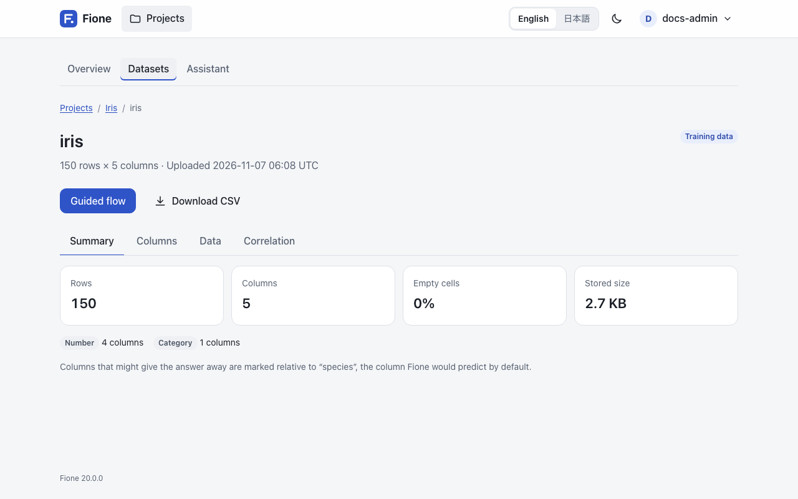
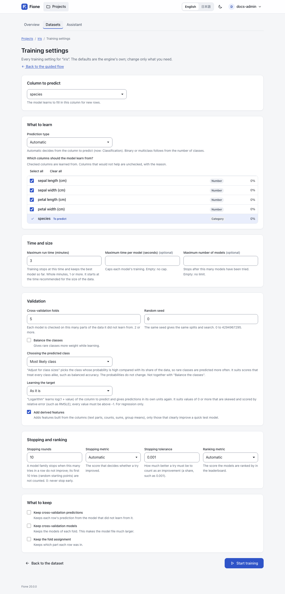
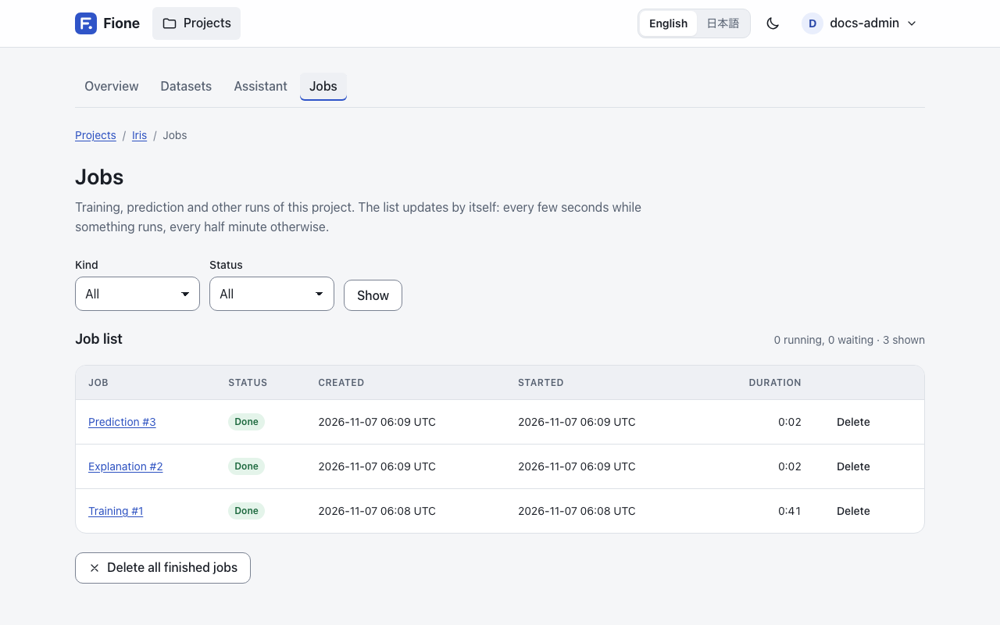
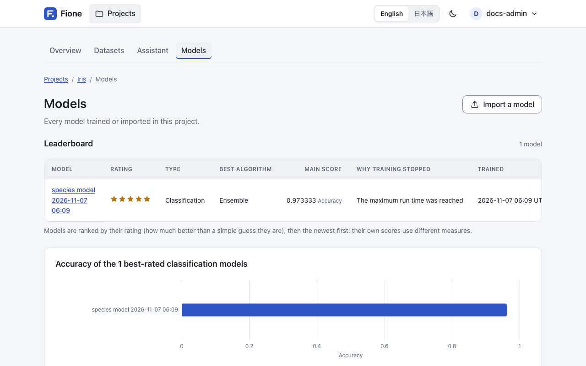

# AutoML screens

The detailed view of Fione is for people who want to see and set everything: the statistics and charts of every column, every training setting, the job list, the models with their leaderboard, and model export and import. If you are new to machine learning, start with the [EasyML wizard](/guide/easyml); everything it does is also available here.

## Switch to the detailed view {#detailed-view}

Open the account menu (your name, top right) and, under **View**, choose **Detailed**. The setting is remembered per browser. It only changes what you see, not what you may do: the same roles and permissions apply in both views.

In the detailed view a project's menu also shows **Models** and **Jobs**, in addition to **Overview**, **Datasets** and **Assistant**. The owner also sees **Sharing** (see [Users and sharing](/guide/users-sharing)). Datasets get a **Train a model on this dataset** button that opens the full training settings.

## Look at your data {#data-analysis}

Open **Datasets** in the project. Upload a CSV with **Upload a dataset** and choose the **Kind of data**:

- **Training data** has the column to predict.
- **Data to predict** does not.
- **Predictions** are results to keep (batch predictions create them for you).

Open a dataset to see four tabs.

**Summary** shows the number of rows and columns, the share of empty cells, the stored size and how many columns there are of each kind (see [Column kinds](#column-kinds)). The details of every column are worked out from the first rows of the data: about two million cells' worth, between 500 and 50,000 rows (fewer rows for wide data). When a sample is used, the tab says how many rows it is based on.

**Columns** lists every column (100 per page) with its kind, the share of empty values, the number of distinct values, the minimum, mean and maximum of numbers, the most common value and a note. The note marks the column to predict that Fione would choose by default (the last column that is not ID-like or constant) and the columns that might give the answer away relative to it (see [Leak warnings](/guide/explanations#leak-warnings)). Click a column name to open its page.

**Data** shows the stored values as text, exactly as stored: up to 200 rows and 50 columns at a time, with buttons to move through the rows and the columns.

**Correlation** shows the 20 most correlated pairs of numeric columns as a chart and a table. The correlation (r) is Pearson's, from -1 to 1: near 1 or -1, two columns rise and fall together; near 0, they do not. A pair needs at least 10 rows where both columns have a value. With fewer than two numeric columns there is nothing to compare.

### One column {#column-page}

A column's page has two cards. **Distribution** is a histogram of 20 ranges for numbers, or a bar chart of the 10 most common values for the other columns (with the rest counted as "other values"). **Statistics** lists the number of values, the empty share, the distinct values and, for numbers, the mean, standard deviation, minimum, 25th percentile, median, 75th percentile and maximum. For numbers it also gives the share of outliers: values more than 1.5 times the spread of the middle half of the data away from it. Statistics and charts come from the same first rows as the other tabs.

### Column kinds {#column-kinds}

Fione detects what each column holds, which decides how it is shown and which columns are left out of the inputs by default.

| Kind | What it means |
|---|---|
| Number | Numbers, including whole numbers that are not codes or IDs. |
| Category | True/false, small whole-number codes (at most 10 different values, and no more than 5% of the number of rows), and text with few different values (at most 50, or at most half as many as there are rows). |
| Text | Text that is not a Category and either averages more than 30 characters or has more than 1,000 different values. |
| Date | Date types, and text where at least 95% of the values read as dates and at least half show a year, a month name or a time. |
| ID-like | A whole-number or text column in which every value is different (at least 20 values). It cannot help to predict. |
| One value | The same value in every row. It cannot help to predict. |

## Training settings {#training-settings}

On a dataset page, press **Train a model on this dataset** (training data only, and you need write access). The page **Training settings** shows every setting. Its defaults are the engine's own; change only what you need. A link, **Back to the guided flow**, returns to the [wizard's](/guide/easyml) data analysis.

At the top, **Column to predict** selects the target; changing it reloads the page for that column. Notes appear above the form when something needs your attention: the column to predict cannot be trained on as it is (too few rows, empty values, one value only, text for a regression, too many classes, a class with a single row), or it looks like an ID; columns might give the answer away; the recommended run time; and tips for a skewed target or a rare class.

### What to learn

- **Prediction type**: **Automatic** decides from the column to predict; the form shows what it detected. Choose **Classification (binary or multiclass)** or **Regression** to override it. Binary or multiclass follows from the number of classes.
- **Which columns should the model learn from?**: the checked columns are the inputs. Columns that would not help are unchecked with the reason: ID-like columns, columns with one value, and columns that are a copy of the answer or whose value decides it. A column that only predicts the answer suspiciously well stays checked, with a warning. Each row also shows the column's kind and empty share. **Select all** and **Clear all** change every box.

### Time and size

- **Maximum run time (minutes)**: training stops at this time and keeps the best model found so far. A whole number of minutes, 1 or more. The field starts at the time recommended for the size of the data (3, 10 or 30 minutes); the same recommendation is shown as a note. Training can finish sooner: the search and the final refit may leave part of the time unused, and the other limits below can end it earlier.
- **Maximum time per model (seconds)**: caps the training of each try. Empty means no cap. A cap too small to fit all the folds of a try is raised, and a notice says so.
- **Maximum number of models**: the search stops after this many tries, counted over all the model families. Empty means no limit.

### Validation

- **Cross-validation folds**: each model is checked on this many parts of the data it did not learn from. 2 or more; the default is 5. Fione lowers it, with a notice, when the data is too small: to the size of the smallest class or to a fifth of the rows, whichever is smaller (never below 2).
- **Random seed**: the same seed gives the same splits and search. 0 to 4294967295. The default is 0.
- **Balance the classes**: gives rare classes more weight while learning. It is ignored for regression.
- **Choosing the predicted class**: see [Choosing the predicted class](#choosing-the-predicted-class).
- **Learning the target**: see [Learning a skewed target](#skewed-target).
- **Add derived features**: on by default; see [Derived features](#derived-features).

### Stopping and ranking

- **Stopping rounds**: a model family stops searching when this many tries in a row do not improve; its first 10 tries (random starting points) are not counted. 0 means never stop early. The default is 10.
- **Stopping metric**: the score that decides whether a try improved. **Automatic** is log loss for classification and RMSE for regression.
- **Stopping tolerance**: how much better a try must be to count as an improvement, as a share (the default is 0.001, that is 0.1%).
- **Ranking metric**: the score the leaderboard of a model ranks by. **Automatic** is the same as for stopping.

The metrics offered for classification are **Log loss (classification)**, **AUC (two classes)** and **Accuracy (classification)**; for regression, **RMSE (regression)**, **MAE (regression)** and **R² (regression)**. A metric that does not fit the prediction type is refused.

### What to keep

Three options, all off by default. **Keep cross-validation predictions** keeps each row's prediction from the model that did not learn from it. **Keep cross-validation models** keeps the models of each fold, which makes the model file much larger. **Keep the fold assignment** keeps which part each row was in.

### Start

Press **Start training**. Anything wrong goes back to the form with a message and nothing is queued. Otherwise the job page opens, which shows the progress (see [Jobs](#jobs)).

### How the run time is spent

The engine spends the maximum run time in phases. First it chooses the derived features (at most a tenth of the time; a short run gives it 30 seconds, never more than 30% of the run). Then it searches, with about 65% of the time that is left. The families run one after another (LightGBM, TextLinear for data with running text, CatBoost, XGBoost, RandomForest, ExtraTrees, DeepLearning, Linear); each gets a share of the search time that is still left, so time one family leaves unused flows to the next. The search is tuned with Optuna and scores each try on the cross-validation folds. The best tries are then blended into an ensemble, the members of the blend are refit on all rows, and time that is still left buys extra refits with other seeds of the best boosting and forest members, whose predictions are averaged. A reserve is kept for packaging the model.

Two size limits apply: a member whose model would be over 40 MiB is dropped, and the members together are kept under 90 MiB. Linear, TextLinear and DeepLearning read a one-hot encoded copy of the data; when that copy would pass 100 million cells (rows times columns of the copy) they are left out of the run, and a notice says so.

## Choosing the predicted class {#choosing-the-predicted-class}

A classification model predicts the class with the largest probability. When one class is much rarer than the others and your score treats every class alike (balanced accuracy, macro recall), set **Choosing the predicted class** to **Adjust for class sizes** (`decision: "balanced"` in the API). The predicted label is then the class whose probability is largest relative to its share of the training data, so rare classes are predicted more often. The probabilities do not change; the accuracy and the confusion matrix of the training result, batch predictions, Fione Serving and the explanations follow the same rule.

It cannot be combined with **Balance the classes**, which corrects the same imbalance while learning, and it is ignored for regression. The training settings page shows a tip when the rarest class is a small share of the rows. The default, **Most likely class**, picks the largest probability.

## Text columns {#text-columns}

A column of running text (the median value has five words or more) is read in two ways. Its topics become derived features (see below). A model family called TextLinear also reads its words: a logistic (or ridge) regression on the TF-IDF weights of words and word pairs, with the other columns beside them, learned again on each training fold. It joins the search and the ensemble only for data with such a column, and its predictions are mixed with the other families' by the same cross-validation scores.

Three variants of it are *late candidates*:

- **TextLinearWide** keeps up to 100,000 words and word pairs per column.
- **TextLinearChar** reads the words and also the character n-grams of 2 to 5 letters. It is left out when the text is very large (about 5 million characters or more) or has no spaces.
- **TextLinearPlain** works without the derived features; it is tried only when derived features were added.

They run after all the other families, in the search time that is left: for text data, 15% of the search time is kept for them (taken from the other families, not from TextLinear), and what the other families leave unused is added. Each takes a share of that time, and one that cannot finish a first trial in its share is skipped. A late candidate stays in the model only when its cross-validation scores improve the ensemble; otherwise it gets weight 0 and is dropped. They are not run for data without a text column.

A text column with more than 200 different values is otherwise read by the models as how often each value occurs; see [Known limitations](/docs/known-limitations).

## Learning a skewed target {#skewed-target}

For a regression target of 0 or more that is skewed (prices, counts, durations) and is scored by relative error such as RMSLE, set **Learning the target** to **Logarithm (log1p)** (`target_transform: "log1p"` in the API). Fione then learns log(1 + value) and gives predictions in the column's own units again. The model's scores, the diagnostics, the leaderboard, batch predictions, Fione Serving and the explanations are all in those units; the explanation shares the change from the bias to the prediction in proportion to each column's effect on the logarithm, which is an approximation. Only the scores of the search itself (the score history) stay on the logarithm scale.

Every value must be above -1, and the setting is ignored for classification. The training settings page shows a tip when the values are 0 or more and skewed.

## Derived features {#derived-features}

With **Add derived features** (`feature_engineering` in the API, on by default), Fione builds features from your columns that never read the target, and chooses among them by validation:

- **Text columns:** the common words (letter runs, so `C85` gives `c`) as 0/1 flags, plus length, word count, share of digits and capitals and the first number. For running text (a median of five words or more) also 32 *topics*, the main directions of word use found by an SVD of the word weights (TF-IDF).
- **Categories:** how common each is, and how common each pair is.
- **Identifiers:** a text column (two of them at most) with at least 12 distinct values and no spaces, whose values (the first 1,000 non-missing ones are judged) split by `_`, `/`, `-`, `:` or `.` into the same two to four fields on at least 95% of them (`0001_01`, `B/0/P`), gets one feature per field: the number for a numeric field and how common the value is otherwise, plus the number of training rows that share the first field (the size of a group). A value not seen in training gives a missing feature, not zero. This group is tried last.
- **Rows:** the number of missing values and of zeros.
- **Dates:** hour, minute, week, quarter, day of the year, weekend, and the seconds between date columns.
- **Numbers:** sums, differences, products and ratios of the few most useful number columns, their means within each of the three most useful small categories (and the difference from it), how common each repeated value is, and k-means clusters with the distance to the cluster centre.

Date features need a column of dates. Date strings such as `25-12-2024 09:00` or `Mar 5, 2024` are recognised, and read with the day first when some first field is above 12 and no second field is (`02-10-2012` is then the 2nd of October), otherwise with the month first. Independently of this option, the linear model and the neural network log-transform non-negative numbers that are strongly skewed.

Each group is tried on a small LightGBM over a sample of up to 20,000 rows, and kept only if the loss drops over paired cross-validation folds by more than three standard errors and by 0.1% on average, with at least 70% of the folds improving; the kept groups together then pass a last check on other folds of the same rows. A run can therefore add none. A notice naming the groups that were added (or "none added") is listed under **See details** on the job page once the job has finished (see [Jobs](#jobs)).

## Jobs {#jobs}

Training, batch predictions, explanations, model exports and Python modules all run as jobs on the server. You can leave a job's page and come back; the run continues.

A job's page shows its status, a progress bar, the elapsed time and the time left (at most), and for a training the models tried and the best error so far (measured on rows the models did not learn from; lower is better). It updates by itself. **Stop training** (or the matching button of the other kinds) stops the job after you confirm; a stopped training saves no model. When the job is done, Fione takes you to the result: for a training, the prediction summary of the new model. To open the job page of a trained model later, use the **Training job** link on the **Overview** tab of its model page. A failed job shows its message and, once it has finished, **See details** lists the notices of the run (the last 20), for example that the folds were lowered or that a family was left out.

**Jobs** in the project menu lists every job of the project: **Training**, **Prediction**, **Module**, **Model export** and **Explanation**. Filter by **Kind** and **Status** (**Queued**, **Running**, **Done**, **Failed** or **Cancelled**). The list shows when each job was created and started and how long it took, refreshes itself (every few seconds while something runs, every half minute otherwise), and offers **Stop** for an active job and **Delete** for a finished one, with a confirmation. **Delete all finished jobs** removes their logs too; the models and predictions they made are kept, and running and waiting jobs stay. All of this needs write access to the project; readers can look at the list.

Explanation jobs, which are queued after each training (unless the server is set not to, see [Configuration](/docs/configuration)), appear in this list but not in the recent jobs on the project's overview page.

## Models, leaderboards and scores {#models}

**Models** lists every model trained or imported in the project: its name, a rating of 1 to 5 stars, the type (classification or regression), the best algorithm, the main score, why training stopped (**The maximum run time was reached**, **Enough models were tried**, **The models stopped getting better**, **Training was stopped** or **An error ended training early**), and when it was trained, with a link to its job. The list is ordered by rating, then newest first, because the scores of different models use different measures. With write access you can delete a model: it can no longer predict, while predictions already made are kept. Below the list, a chart compares the models of each type. See [EasyML](/guide/easyml) for how the rating is calculated.

A model's page has these tabs:

- **Overview**: the rating, a comment from the Assistant, the best model (often a blend of several), the training data, the number of models tried, the training time and the training settings. Its **Serving** card offers the serving bundle for [Fione Serving](/docs/serving).
- **Leaderboard**: one row per model, up to three per algorithm tried (named like `LightGBM_12`: the algorithm and the number of the try), best first, scored by the **Ranking metric** on rows the models did not learn from (**CV score**), with the **Spread over folds**, the **Weight** in the final blend, the **Training time** and the **Settings of its best try**. The last row, **Ensemble**, is the blend. Only the algorithms with a weight above 0 are in the final model.
- **Importance**: the inputs the model relied on most, as a share of everything it used. It comes from how the models were built (gain for boosting, impurity for forests, weights for the linear model and the neural network); a derived feature counts for the columns it reads. For importance worked out from the predictions themselves, see [Model explanations](/guide/explanations).
- **Explain**: importance from each column's contributions, partial dependence curves and the means to compute them again. See [Model explanations](/guide/explanations).
- **Score history**: each point is one try, in the order they ran, with a dashed line for the best so far. The score is the loss of the search (log loss or RMSE); lower is better. It is on the logarithm scale when the target is learned as a logarithm.
- **Metrics**: the cross-validation scores of the final blend, measured on rows the models did not learn from: log loss, accuracy and (for two classes) AUC, or RMSE, MAE and R², each with a one-line meaning. Below them are the diagnostics charts, described in [Model explanations](/guide/explanations).

The cross-validation scores are slightly optimistic; data held back from training gives the honest number (see [Known limitations](/docs/known-limitations)).

## Export and import models {#export-import}

**Export** on a model's page downloads that model as a zip; anyone who can read the project can do it. **Export all models** on the **Models** page packs every model of the project into one zip as a job; only the latest such export of a project is kept, and a new one replaces it.

**Import a model** on the **Models** page (administrators only) adds a zip made by an export, from this or another Fione installation, to the project. A model file can run code on the server when it is loaded, so Fione loads only models whose signature was made by this installation. For a model from another installation, an administrator who knows where the file comes from can tick **Trust a model from another Fione installation**. The model is then marked **Imported, unverified**, and the web pages do not open it to explain it; only an explanation job can. An export may be at most 512 MiB.

## Batch predictions {#batch-predictions}

On a model's page, press **Make predictions** (you need write access).

1. Upload a CSV. The page lists the columns the model needs; other columns are fine. The column to predict is not needed. A missing column is named so you can fix the file.
2. Choose the **Columns in the result**. The prediction is always included; the checked columns of your file are copied next to it.
3. Optionally tick **Explain each prediction** to add each row's contributions (see [Model explanations](/guide/explanations#contributions)). It is slower.
4. Press **Predict**. A job runs, and the result page shows the first rows and offers the CSV for download.

The result has a `predict` column (the predicted class or value) and, for classification, one `p_<class>` column per class with its probability. The result is also saved as a dataset of the kind **Predictions**, named `predict_<name>` after the data it came from, so you can find it again under **Datasets**.

## Next steps

- [Model explanations](/guide/explanations): diagnostics, importance, partial dependence, contributions and leak warnings.
- [Python client](/guide/sdk) and [REST API](/docs/rest-api): drive the same steps from scripts.
- [Fione Serving](/docs/serving): run a trained model as a prediction API.
