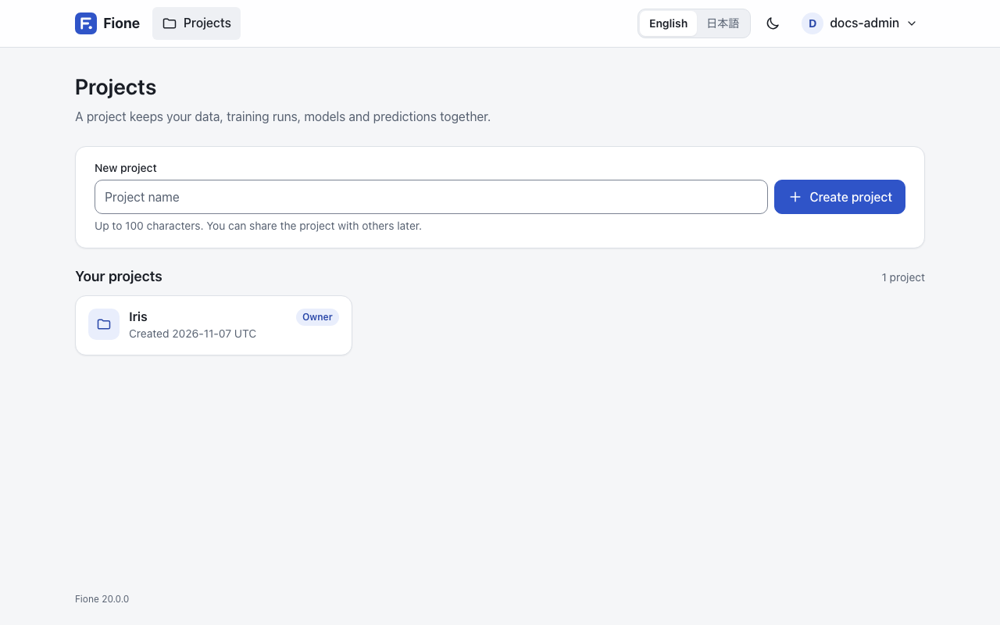
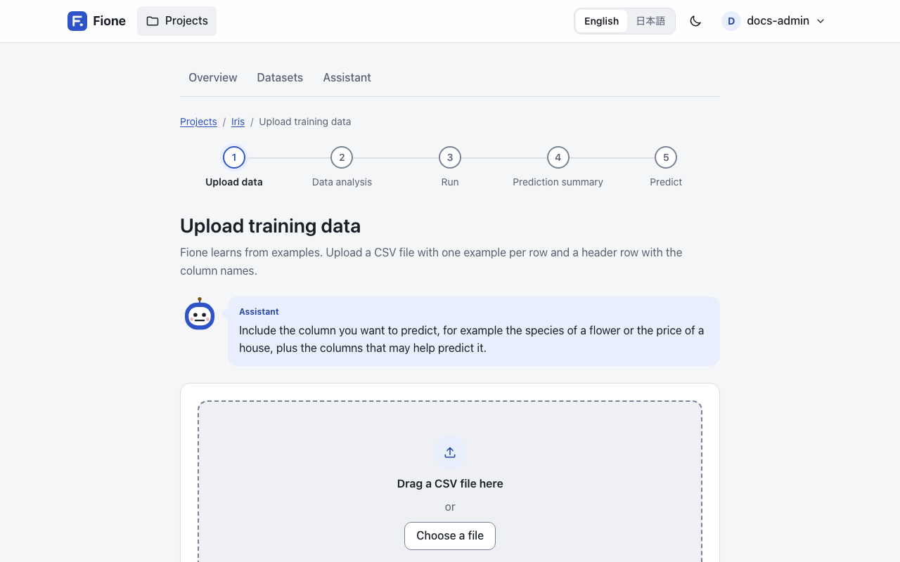
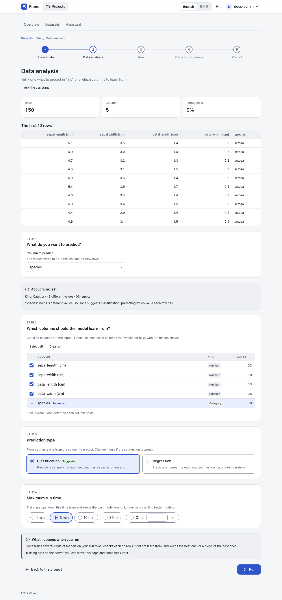
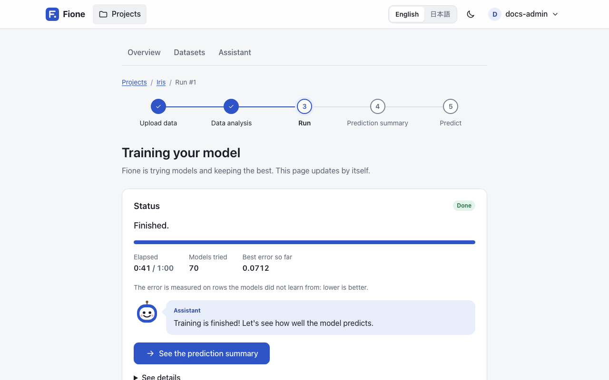
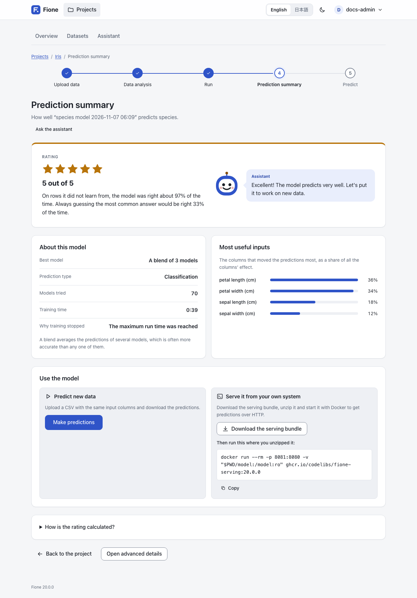
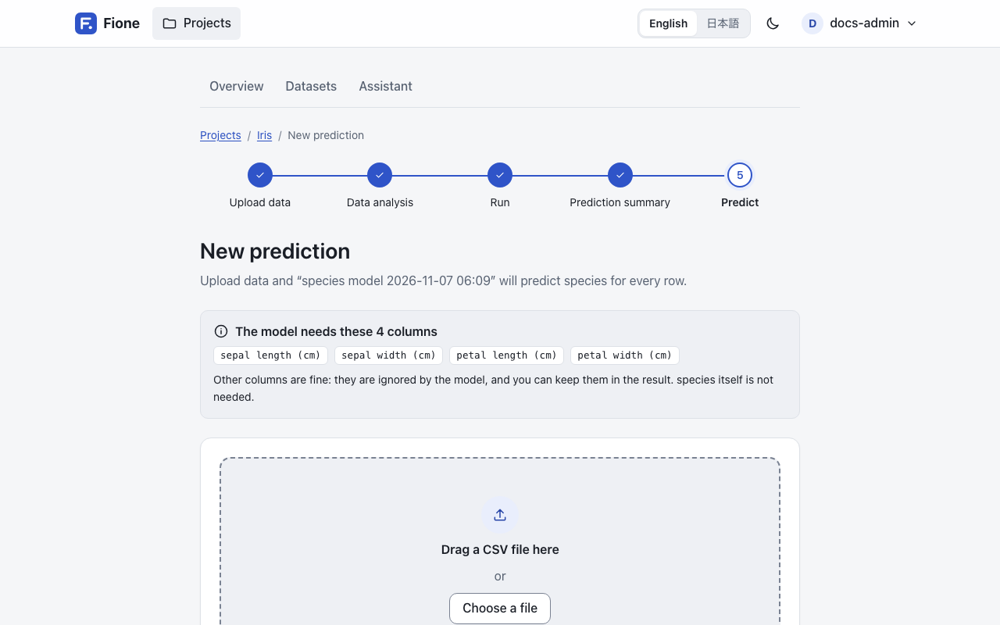
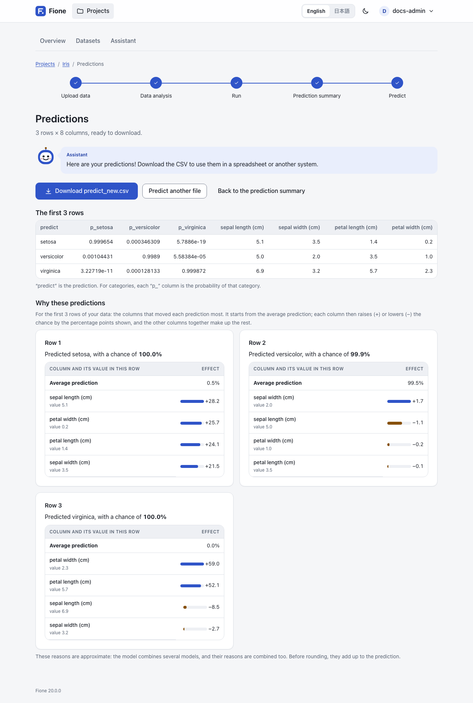

# EasyML wizard

The EasyML wizard takes you from a CSV file to a trained model, a prediction file and a running prediction API. It is the default view of Fione, and it needs no machine-learning experience.

The wizard has five steps, shown as a progress bar at the top of each page: **Upload data**, **Data analysis**, **Run**, **Prediction summary** and **Predict**. This page walks through them with the iris sample from [Installation](/guide/installation); any CSV with a header row works the same way.

Creating projects, uploading data, training and predicting need the Administrator or Editor role, and edit access to the project. A Viewer can look at what is shared with them but cannot change anything (see [Users and sharing](/guide/users-sharing)).

## 1. Create a project

A project keeps your data, training runs, models and predictions together.



1. Open **Projects**, type a name under **New project** (for example `Iris`) and press **Create project**.
2. Open the project.

## 2. Upload data

1. In the project, press **Upload training data**.
2. Choose `iris.csv` (or drag it onto the page) and press **Upload and analyze**.



The file needs a header row with the column names and one example per row. Include the column you want to predict (the species of a flower, the price of a house) and the columns that may help predict it.

## 3. Data analysis

**Data analysis** shows the number of rows, columns and empty cells, the first rows of your data, and the choices that define the training:



- **What do you want to predict?** Fione suggests the column to predict (`species` for the iris data). Choose another column and press **Update** to change it.
- **Prediction type.** Fione suggests classification (predicting which category each row has) or regression (predicting a number for each row), marked **Suggested**. Change it only when the suggestion is wrong.
- **Which columns should the model learn from?** Checked columns are the inputs. Fione unchecks columns that would not help, with the reason shown: a column that is a copy of the answer, a column whose value decides it, a column that only identifies rows, or a column with one value. A column that predicts the answer suspiciously well on its own stays checked, with a warning: check that its value is known when you make predictions.
- **Maximum run time.** Choose **1 min**, **3 min**, **10 min**, **30 min** or **Other** for a number of minutes of your own. Training stops when this time is up and keeps the best model found; longer runs can find better models. Fione starts from a time that suits the size of your data and tells you when it chose a longer one.

Above these choices, the Assistant comments on the data in plain words and may propose a training run that you can start with one button (**Start training**). This needs a language model; without one the comment is replaced by a note that the assistant is not available, and you can continue by hand. See [Assistant](/guide/assistant).

For the iris data, keep the suggestions, choose **1 min** under **Maximum run time** and press **Run**.

## 4. Run

The progress page, **Training your model**, shows what Fione is doing: the models tried so far, the best error so far, the time elapsed and the time left. The page updates by itself. Training runs on the server, so you can leave the page and come back later; **Stop training** ends it without saving a model.



When training ends, press **See the prediction summary**.

## 5. Prediction summary

The **Prediction summary** opens with:



- the best model, and a **Rating** from 1 to 5 stars;
- what the score means in plain words, measured on rows the model did not learn from, next to a simple guess for comparison;
- a short comment from the Assistant (when a language model is available);
- **About this model**: the best model (or a blend of several models), the prediction type, the models tried, the training time and why training stopped;
- **Most useful inputs**: the columns the model relied on most.

**How is the rating calculated?** explains the rating. Fione tests the model on rows it did not learn from (cross-validation) and compares it with a simple guess: always the most common category for classification, always the average for regression. Fione turns that comparison into a score from 0 to 1: below 0.2 is one star, and each further 0.2 adds a star.

If training hit an error, Fione keeps the best model it had by then and says so on this page; such a model gets at most 2 stars. Running again may help.

## 6. Make predictions

1. On the summary, press **Make predictions**. The page is **New prediction**.
2. Choose a CSV that has the same input columns as the training data (the column to predict is not needed, so `iris.csv` works) and press **Upload**. If columns are missing, Fione lists them so that you can add them and upload again. Other columns are fine; the model ignores them.
3. Under **Columns in the result**, choose which columns of your file to keep next to the prediction. The prediction is always included. Select **Explain each prediction** to add a `contrib_` column per input showing how much it moved each row's prediction; this is slower.
4. Press **Predict**.





The **Predictions** page shows the first rows and offers the file for download (for `iris.csv`, **Download predict_iris.csv**). The file has a `predict` column with the predicted class, and one `p_<class>` column per class with its probability. For a regression model, `predict` is the predicted number. The result is also stored in the project as a dataset of the kind **Predictions**.

Under **Why these predictions**, Fione shows for the first 5 rows which columns moved each prediction most, starting from the average prediction.

## 7. Serve the model

To use the model from your own systems, run it as a prediction API with Fione Serving. On the summary, the card **Serve it from your own system** offers **Download the serving bundle** (a zip with the model files) and shows a `docker run` command.

Build the serving image once. It must be built with the same tag as Fione, because a model records the tag of the image that trained it and Fione Serving only loads models of its own tag:

```sh
docker compose -f docker/compose.yaml --env-file docker/.env --profile serving build fione-serving
```

Then, in the directory where you downloaded the bundle:

```sh
unzip fione-serving-*.zip
docker run --rm -p 8081:8080 -v "$PWD/model:/model:ro" ghcr.io/codelibs/fione-serving:dev
```

In another terminal, send one row with the input columns of the model:

```sh
curl -s -X POST localhost:8081/invocations -H 'Content-Type: application/json' -d '{"instances":[{"sepal length (cm)":5.1,"sepal width (cm)":3.5,"petal length (cm)":1.4,"petal width (cm)":0.2}]}'
```

The answer looks like the following; the probabilities differ from model to model:

```json
{"predictions":[{"label":"setosa","index":0,"class_probabilities":[0.9934803442259019,0.003455065889847104,0.0030645898842508773]}]}
```

Press Ctrl+C to stop it. The prediction API has no authentication, and `-p 8081:8080` opens it on every network interface of this machine. To keep it on this machine only, use `-p 127.0.0.1:8081:8080`. The command in the card uses the tag of the image that trained the model, so use that command if you built Fione with a tag other than `dev`. For the API itself, see [Fione Serving](/docs/serving).

## Beyond the wizard

Choose **Detailed** under **View** in the account menu (your name, top right) for the AutoML screens. The view only changes what you see, not what you may do, and it is remembered per browser. The detailed view adds:

- every column's statistics and charts, and the full training settings, which start with the run time recommended for the size of your data and show the same warnings and tips as **Data analysis**: see [AutoML screens](/guide/automl);
- the job list and the models with their leaderboard, variable importance and score history, plus model export and import: see [AutoML screens](/guide/automl);
- diagnostics, explanations and leak warnings: see [Explanations and leak warnings](/guide/explanations);
- project sharing: see [Users and sharing](/guide/users-sharing).

Administrators also manage users, Python modules and the system status from the account menu. To drive Fione from Python, use [Python client (fione-sdk)](/guide/sdk). To ask questions about your data and models in plain language, use the [Assistant](/guide/assistant). To run Fione in production, see [Operations](/docs/operations).
