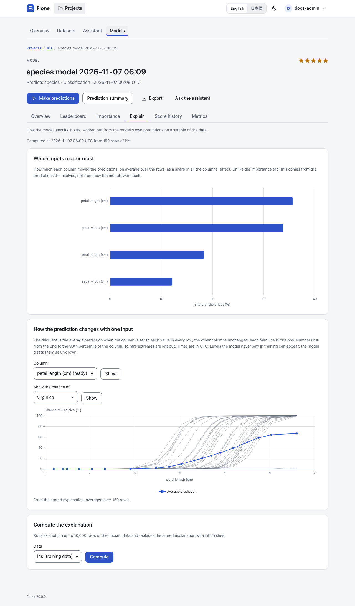

# Model explanations and leak warnings

A rating tells you how well a model predicts. Explanations tell you how it gets there and whether you can trust it. Fione gives you three kinds, all on a model's page in the project (**Models**, then the model), and a warning about leaks while you prepare the training.

| What | Where | Computed from |
|---|---|---|
| [Diagnostics](#diagnostics): confusion matrix, per-class figures, ROC and precision-recall curves, calibration, residuals | **Metrics** tab | the cross-validation predictions of training |
| [Importance and partial dependence](#importance) | **Explain** tab | the model's predictions on a sample of the data |
| [Each prediction's contributions](#contributions) | prediction results, batch predictions, the REST API, Fione Serving | the model, for the rows you give it |
| [Leak warnings](#leak-warnings) | data analysis, dataset pages | the training data, before training |

The model's tabs are part of the detailed view (see [AutoML screens](/guide/automl#detailed-view)); the reasons for the first rows of a prediction also appear in the simple view.

## Diagnostics {#diagnostics}

The **Metrics** tab of a model shows its cross-validation scores and, below them, charts and tables worked out from the **cross-validation predictions** of the final blend: for every training row, the prediction of models that did not learn from that row. They say how the model behaves on data it has not seen, in a way the single score cannot.

The tab states how many rows they come from. Above 200,000 rows a random sample is used.

### Classification

- **Confusion matrix**: rows are the actual classes, columns the predicted ones. Each cell gives the number of rows and their share of the actual class; the larger the share, the stronger the colour. The diagonal is what the model got right. Only the 30 largest classes have their own row and column; the rest are counted together as **Other classes**.
- **Per-class figures**: **Precision** (of the rows predicted as the class, the share that were), **Recall** (of the rows of the class, the share found), **F1** (the two combined) and the number of rows. A dash means the value is undefined, such as the precision of a class that was never predicted. Only the largest classes are listed when there are very many.
- **ROC curve**, **Precision and recall** and **Calibration** are shown for two classes only, for the second class (the last in sorted order, which the chart names). The ROC curve shows how well the model ranks that class's rows above the others over every threshold, with the area under the curve (AUC); the dashed diagonal is guessing. The precision and recall curve compares the share of correct predictions of that class with the share of its rows found, over every threshold. The calibration chart groups the rows into 10 bins by predicted probability and compares it with the share that really was in the class; a well-calibrated model stays near the dashed diagonal.

### Regression

- **Residuals**: a histogram (30 bins) of actual minus predicted. A positive residual means the model predicted too low.
- **Actual and predicted values**: a scatter of up to 2,000 randomly chosen rows, in random order; a point on the dashed diagonal was predicted exactly.
- The mean residual in each tenth of the rows, ordered by predicted value, shows whether the model is biased in some range.

### Good to know

- Because early stopping and the ensemble weights use the same predictions, the diagnostics are slightly optimistic, like the cross-validation scores.
- A model has no diagnostics if it was imported without them, or if they could not be computed or took more than 256 KiB.
- Diagnostics keep training values: the class labels and, for regression, up to 2,000 actual target values with the model's predictions for them. Every reader of the project sees them (the tab and `GET /api/v1/models/{id}/diagnostics`), they go into the model's export, and they stay when the training dataset is deleted. The model file and the serving bundle carry no diagnostics.

## Importance and partial dependence {#importance}

The **Explain** tab shows how the model uses its inputs, worked out from the model's own predictions on a sample of the data.



An **explanation job** computes it after each training (it appears in the job list as **Explanation**; the server can be set not to queue it, see [Configuration](/docs/configuration)). It reads up to 10,000 rows of the training data and stores two things:

- **Which inputs matter most**: how much each column moved the predictions, on average over the rows, as a share of all the columns' effect. It is the mean absolute contribution (see [below](#contributions)) of at most 1,000 rows, sampled so that each class keeps its share. This is different from the **Importance** tab, which comes from how the models were built (gain, impurity, weights): the Explain tab comes from the predictions themselves. A derived feature counts for the columns it reads, split equally when it reads several.
- **Partial dependence** curves for the 10 most important columns (see the next section).

The tab says when and from how many rows of which dataset the explanation was computed.

**Compute the explanation** (write access) runs the job again on a dataset you choose, with up to 10,000 rows, and replaces the stored explanation when it finishes. Use it for a model whose training data is gone, or an imported model: they have no dataset of their own, so choose one that has all the columns the model uses. Until then the page shows only curves already stored.

### Partial dependence {#partial-dependence}

Choose a column under **How the prediction changes with one input** and press **Show**. The thick line is the average prediction when the column is set to each value in every row, with the other columns unchanged; each faint line is one row (single-row lines are kept for one class only, at most 50 rows). A steep line means the column strongly moves the prediction; a flat one, that it hardly matters; a bend, a non-linear effect.

- Numbers use up to 20 points from the 2nd to the 98th percentile of the column, so rare extremes are left out. A category uses its most frequent levels (up to 19) and a point for missing values. Times are in UTC. Levels the model never saw in training can appear; the model treats them as unknown.
- Columns whose curve is already stored are marked **(ready)**. For any other column of the model, the curve is computed on the spot from at most 300 rows, so its points can differ slightly from stored curves.
- For classification, choose the class under **Show the chance of**; for regression the curve is the predicted value.

## Each prediction's contributions {#contributions}

A contribution says how much one input column moved one prediction away from the model's average prediction. For one row:

```text
bias + contribution(column 1) + contribution(column 2) + ... = the prediction
```

The sum holds to rounding. The unit is the prediction's own: probability points for classification (not log-odds), the target's units for regression. Fione explains one output per row: for two classes the probability of the second class (the last `p_` column), for more classes the predicted class (the REST API accepts a `class_index` for another), and for regression the value.

The contributions are approximate. Each ensemble member contributes natively: TreeSHAP for LightGBM, XGBoost and CatBoost, path contributions for RandomForest and ExtraTrees, the exact coefficient times the distance from the training mean for Linear and TextLinear, and integrated gradients for DeepLearning. They are converted to probabilities and combined over the ensemble. Exact Shapley values exist only for each booster on its own, before that conversion. A derived feature counts for the columns it reads, split equally when it reads several.

### In the prediction results

When you open the result of a prediction, a card, **Why these predictions**, explains the first 5 rows: for each row, the columns that moved the prediction most (top 5), with the column's value in that row and its effect in percentage points (or in the target's units), then **Other columns** together. It starts from the **Average prediction**. For a model that takes a while to explain, press **Show why** to compute the reasons when you ask. A model with very many columns and classes is not explained there.

### In batch predictions

Tick **Explain each prediction** on the prediction form (`include_contributions` in the API). The result gains a `contrib_<column>` column for each input of the model, then `contrib_bias`, the average prediction (`contrib_bias_2` when an input is named `bias`). If an input column of your own file has the name of one of these columns, your column is kept as `input_<name>`. The result page previews the first 20 contribution columns; the download has all of them.

This is much slower than a plain prediction and is limited to 100,000 rows. Each row gains one number column per input plus one, so a very wide model makes a very large file. See [AutoML screens](/guide/automl#batch-predictions) for the prediction form.

### In the REST API

With an API token (see [REST API](/docs/rest-api)):

```sh
curl -s -X POST http://127.0.0.1:8080/api/v1/models/<model-id>/contributions \
  -H "Authorization: Bearer <your-token>" -H "Content-Type: application/json" \
  -d '{"instances":[{"sepal length (cm)":5.1,"sepal width (cm)":3.5,"petal length (cm)":1.4,"petal width (cm)":0.2}]}'
```

Give either up to 100 `instances` (objects keyed by column, like Fione Serving) or a `dataset_id` with an `offset` and a `limit`. Each row of the answer has the `prediction`, the `bias` and the `contributions` per column, with a `class_index` for more than two classes. Related endpoints:

- `POST /api/v1/models/{id}/partial-dependence`: one column's curve (`column`, optionally `dataset_id`, `grid`, `rows`, `ice`, `class_index`).
- `GET /api/v1/models/{id}/explanations`: the stored importance and curves, and the status of the explanation job.
- `GET /api/v1/models/{id}/diagnostics`: the diagnostics.
- `POST /api/v1/projects/{id}/jobs/explain`: queue the explanation job (write access).

Read access to the project is enough for the contributions endpoint and the first three endpoints listed here; queuing the explanation job needs write access. Contributions and partial dependence are computed on request, one at a time for the whole server; a request that has to wait too long answers `503` (busy) with a `Retry-After` header. A model whose file is over 512 MiB, or an import that was not signed by this installation, is refused there (`409`) and can be explained only by the explanation job.

### In Fione Serving

Add `"contributions": true` to a request to `/invocations` to get, for each predicted row, a `contributions` object with the `bias` and the value of each input column. A request takes at most 100 instances, and at most 2 such requests run at once. See [Fione Serving](/docs/serving) for the request, the response and the limits.

## Leak warnings {#leak-warnings}

A *leak* is a column that gives the answer away, such as a value that is only recorded after the outcome is known. A model that learns from it looks excellent in training and fails on new data, where the value is not known. Fione looks for suspect columns before training and tells you.

You see the result in the data analysis of the wizard (see [EasyML](/guide/easyml)), on the training settings page, in the **Notes** column of a dataset's **Columns** tab and on the page of a column. They are judged against the column Fione would predict by default, or the one you choose.

There are two levels:

- **Exact leaks are unchecked.** A column identical to the column to predict, or each of whose values always comes with the same answer, is left out of the inputs by default, with the reason. (Columns that only identify rows are unchecked too, as IDs.)
- **Suspicious columns stay checked, with a warning.** A column that predicts the answer on its own suspiciously well, one whose values (or where they are missing) follow the answer, such as an ID or a date when rows were added in order of the answer, and one that moves almost exactly with the answer (a correlation of 0.99 or more in absolute value). Check that the value is really known when you make predictions, and uncheck the column if it is not.

How the score works: each column alone is cut into bins and used to predict the column to predict out of fold, and the result is scored with AUC (classification; the mean one-against-rest AUC for more than two classes) or R² (regression). A column is flagged at an AUC of 0.95 (R² of 0.90 for regression) and 0.10 above the best column under that line, or at 0.99 in any case.

Warnings can be wrong in both directions: a strong legitimate column can be flagged, and a leak can be missed, so no warning does not mean no leak. See [Known limitations](/docs/known-limitations#explanations-and-leak-warnings) for the cases it misses. The check uses at most 10,000 rows, does not score data under 200 rows, and stops after 3 seconds, saying that some columns were not checked.

## Next steps

- [AutoML screens](/guide/automl): the model tabs, leaderboards and training settings.
- [Fione Serving](/docs/serving): contributions in the prediction API.
- [Known limitations](/docs/known-limitations): what the explanations do not do.
