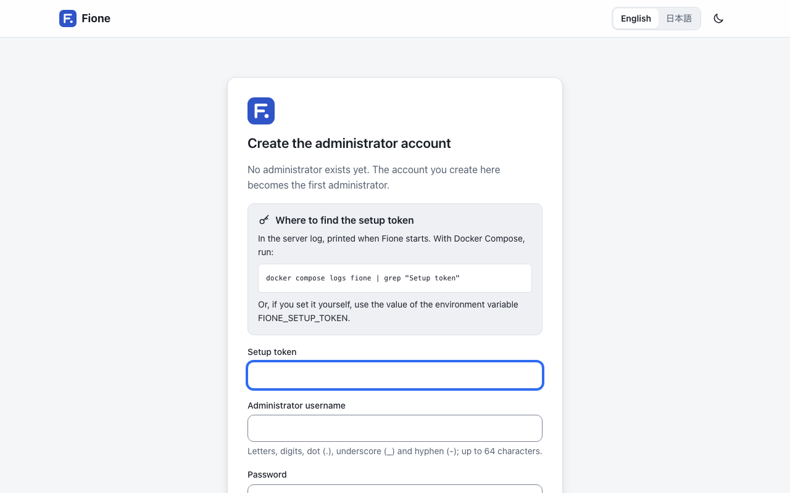

# Installation and quick start

This page takes you from nothing to a running Fione with an administrator account, using Docker. Allow a few minutes for the first build.

## What you need

- Docker with Compose v2 (Docker Desktop, or Docker Engine with the compose plugin).
- About 6 GB of disk space for the images and their build cache, plus room for your data.
- `git`, `openssl`, `unzip` and `curl`.
- A recent browser: Chrome or Edge 123+, Firefox 120+ or Safari 17.5+ (older ones get the light theme only).

The images are built on your machine from the Fione repository, on amd64 or arm64 (Apple silicon).

## 1. Get Fione and set its secrets

```sh
git clone https://github.com/codelibs/fione.git
cd fione
printf 'FIONE_S3_ACCESS_KEY=%s\nFIONE_S3_SECRET_KEY=%s\n' "$(openssl rand -hex 16)" "$(openssl rand -hex 32)" > docker/.env
```

`docker/.env` holds the credentials that Fione and its storage (SeaweedFS) share. Git ignores it; keep it private. Compose refuses to start while either value is empty. `docker/.env.example` lists the other optional values, and [Configuration](/docs/configuration) describes every setting.

## 2. Start it

```sh
docker compose -f docker/compose.yaml --env-file docker/.env up -d --build --wait
```



The first build downloads and installs the machine-learning libraries and takes a few minutes. `--wait` returns when both containers (`fione` and `seaweedfs`) are healthy. Fione is then at <http://127.0.0.1:8080/>. The port is published on this machine only; to serve other people, put a reverse proxy with HTTPS in front of it (see the reverse proxy notes in [Configuration](/docs/configuration)).

## 3. Create the administrator

Fione has no default password. Until an administrator exists, it writes a setup token to its log at every start:

```sh
docker compose -f docker/compose.yaml --env-file docker/.env logs fione | grep "Setup token"
```

Open <http://127.0.0.1:8080/>. The page **Create the administrator account** asks for:

- the **Setup token** from the log,
- an **Administrator username** (letters, digits, dot, underscore and hyphen; up to 64 characters),
- a **Password** of 8 characters or more, and **Confirm password**.

Press **Create administrator** and you are signed in.

Do this soon after the first start: until an administrator exists, anyone who can read the log can do it. If you prefer to choose the token yourself, set `FIONE_SETUP_TOKEN` (16 characters or more) in `docker/.env` before starting. The token stops working once an administrator exists.

Afterwards, people sign in on the login page with their username and password. An administrator adds the other users; see [Users and sharing](/guide/users-sharing).

## 4. Get a CSV to try

Any CSV with a header row works. To try with the classic iris flowers, export the copy that ships with scikit-learn from the running container:

```sh
docker compose -f docker/compose.yaml --env-file docker/.env exec -T fione python -c "from sklearn.datasets import load_iris; d = load_iris(as_frame=True); f = d.frame; f['species'] = d.target_names[f.pop('target')]; f.to_csv('/dev/stdout', index=False)" > iris.csv
```

This writes `iris.csv`: 150 rows, four measurements and the `species` column. Fione accepts CSV files in UTF-8, Shift_JIS or EUC-JP, separated by commas, semicolons, tabs or `|`, with the column names in the first row. The default upload limit is 1 GiB.

## About the assistant banner

The assistant needs a language model, which this quick start does not set up. Until one is reachable, a banner on the pages tells you that the assistant cannot answer yet (for example, "The assistant cannot reach its language model server right now."). That is expected: training, predictions and serving work without it, and only the assistant's comments and proposals are missing. To add a language model, see [Assistant](/guide/assistant).

## Next step

Continue with the [EasyML wizard](/guide/easyml) to train your first model on `iris.csv`. To stop, back up or upgrade Fione later, see [Operations](/docs/operations).
