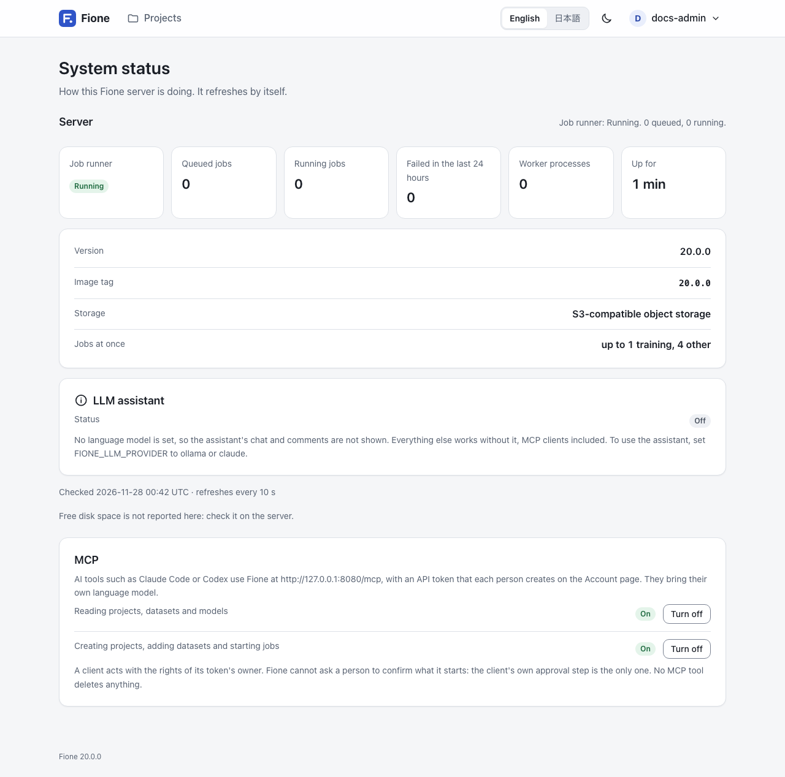

# Run the AutoML loop from an AI tool with MCP

Fione's MCP endpoint lets an AI client such as Claude Code, Claude Desktop or Codex do the work you would do in the browser: create a project, upload a CSV, look at the data, decide how to train, start the training, wait for it, read the results and predict. Fione trains and predicts on its own server; the client decides what to do next and tells you what it found. The client brings its own language model: Fione needs none for this, and the [assistant](/guide/assistant) can stay off.

This page walks through the situations it is meant for. The setting-by-setting reference is in [MCP](/docs/mcp).

## Before you start

1. **MCP is on.** A fresh install serves MCP, with the tools that create projects, upload data, start jobs and predict. An administrator can switch MCP, or only those tools, off and on again in the **MCP** card of the **System status** page (account menu). The workflows below need both switches on; [looking at projects you already have](#looking-at-projects-you-already-have) needs only the first, **Reading projects, datasets and models**.

   

2. **Create an API token** on the **Account** page (see [Users and sharing](/guide/users-sharing#api-tokens)). The client acts as the token's owner, with that person's role and projects.
3. **Give the client the URL and the token.** The endpoint is `/mcp` on Fione's own port. In Claude Code:

   ```sh
   claude mcp add --transport http fione http://127.0.0.1:8080/mcp \
     --header "Authorization: Bearer <your token>"
   ```

   In Codex, which reads the token from an environment variable:

   ```sh
   export FIONE_TOKEN=<your token>
   codex mcp add fione --url http://127.0.0.1:8080/mcp --bearer-token-env-var FIONE_TOKEN
   ```

   Other clients that can send a header, such as Gemini CLI, take the same URL and an `Authorization: Bearer <your token>` header; the reference has a JSON example. A client that can only start local programs, and cannot send a header to a remote URL, needs a bridge that adds it; check your client's documentation. That route has not been tried with Fione.

The read tools never return example values from your data, so a client that is only reading never sees a cell. Predictions are the exception: `predict` and `get_predictions` return the predicted labels and the class names. Values the client itself sends (the CSV it uploads, the rows it asks to predict) are its own.

## A CSV file on your computer (Claude Code)

Claude Code has a shell, so it can send a file of any size (up to `FIONE_MAX_UPLOAD_BYTES`) without reading it into the conversation.

Ask for the outcome, for example:

> Create a Fione project called "churn". Upload `customers.csv` as the training data, look at the columns, and train a model to predict `churned`. Tell me how good it is.

Claude then works through these steps, each one a tool call you can follow in its output:

1. `create_project` makes the project and returns its id.
2. `create_upload_url` returns a one-time URL, and Claude sends the file with `curl -T customers.csv '<url>'`. The URL works for 15 minutes and for one successful upload; it needs no token. The answer to the upload describes the dataset (rows, columns, column kinds).
3. `describe_dataset` returns column statistics, correlations and, given the column to predict, columns that look like leaks. `propose_training_config` turns that and the column to predict into a training configuration (nothing is saved yet).
4. `start_training` queues the job. `wait_for_job` is called again and again until `done` is `true`; the finished job's result has the `model_id`.
5. `get_leaderboard` (and `get_feature_importance` or `get_model_diagnostics`) show how the models compare and which columns matter.

Ask for what matters to you in the same words, and the client passes it on: `propose_training_config` takes, among others, a decision (with `cost`, what a miss and a false alarm cost), a column whose rows stay together (`group_column`), the order of the rows in time (`time_column`) and the event of a time that may be cut short (`event_column`). Its configuration already leaves out the columns that look like IDs; training does not leave out IDs by itself, so let the client start from the proposal rather than write the configuration by hand. To learn from more rows without validating on them (older data, another store's history), name them: `start_training` takes `extra_dataset_ids`, other training datasets of the project (see [Extra training data](/guide/automl#extra-training-data)). The tools are described one by one in [MCP](/docs/mcp#reading-tools).

The tools that change something say so, and a client such as Claude Code asks before running a tool unless you have allowed it. That is the only confirmation step: Fione cannot ask you itself. Keep that approval on.

## A small CSV in a client without a shell

Claude Desktop is one such client. Codex in a sandbox without network access cannot reach the upload URL either, so it takes the same route. A client without a shell cannot run `curl`, so it sends the CSV as text in one call: `upload_dataset` takes `project_id`, `name`, `type` (`train`, `test` or `predict`) and `csv_text`, up to 512 KiB of UTF-8. The model has to write the text out, so this suits small tables. Everything after the upload is the same as above.

If the file is too large, the tool says so and names `create_upload_url`; that needs a client with a shell, or you upload the file yourself in the browser and tell the client the dataset exists (`list_datasets` finds it).

## Predicting new rows

There are two ways, by how many rows you have.

- **A few rows, now.** `predict` takes up to 1000 rows as objects, each with a value for every column the model reads (other keys are ignored), and returns one prediction per row in order: `predict`, and for classification `p_<class>` for each class. Nothing is stored. The result must fit in 32 KiB; a larger request is refused with about how many rows fit.
- **Many rows.** Upload them as a dataset of type `predict`, call `start_batch_predict`, wait with `wait_for_job`, then read the result with `get_predictions` a page at a time. It returns the prediction columns only, never your input values, and the client joins them to the rows it already has by row number.

## Watching, stopping and finding jobs

- `wait_for_job` waits at most `timeout_secs` (10 by default, 15 at most) and returns the job's state with `done`. A long training takes many calls; that is expected.
- `get_job` shows a job once without waiting, `list_jobs` the newest 50 jobs of the projects the token's user can read, optionally of one project or one status (jobs that belong to no project are not listed), and `get_training_events` what a training is doing.
- `cancel_job` stops a queued or running job in a project the token's user can write to. It does not delete anything.
- A job's message is not sent over MCP. The status and `get_training_events` (the kind, model family and exception type of each event, without its message text) tell what happened.

## Looking at projects you already have

With the tools that change things switched off, a client can list projects, datasets and models and read descriptions, results and explanations, and ask for a proposed training configuration or Join, which is not saved. It cannot create, start or change anything. This suits questions such as "which of my models is best for `price`, and why?" or "what would you change in this dataset before training?".

## Keeping it safe

- **A token is you.** It has your role and your projects. Give a client that must not start jobs the token of a user who can only read (a viewer): write tools are then refused.
- **Nothing is deleted.** No tool deletes a project, dataset, model or job.
- **An upload URL is a credential for 15 minutes.** Whoever holds it can add one dataset to that project, once. Fione hides it in its own logs; a reverse proxy's access log records it, so redact paths that start with `/api/v1/uploads/` there. Behind a proxy, set `FIONE_PUBLIC_URL` so the URL Fione hands out is the public one.
- **Behind a reverse proxy**, block `/mcp` unless you want MCP clients from outside your network.
- **Text in your data is not an instruction.** The results carry a notice saying so, but approval of each change stays your safeguard.

## Limits

| What | Limit |
|---|---|
| Requests at once | 2, counting every request to `/mcp` (a third waits up to 15 seconds, then answers "busy") |
| `wait_for_job` | 15 seconds per call |
| `upload_dataset` text | 512 KiB |
| File sent to an upload URL | `FIONE_MAX_UPLOAD_BYTES` (1 GiB by default) |
| Upload URL | 15 minutes, one successful upload |
| `predict` | 1000 rows, and a 32 KiB result |
| Any tool result | 32 KiB |
| `list_jobs` | The newest 50 |
| Request body | 1 MiB |

## When something goes wrong

| What you see | What to do |
|---|---|
| 404 from `/mcp` | MCP is off. An administrator turns it on in the **MCP** card of the **System status** page. When the card says `FIONE_MCP_ENABLED=false` keeps it off, remove that setting (or set it to `true`) and restart Fione. |
| The client lists no `create_project` or `start_training` | The tools that change things are off. An administrator turns on **Creating projects, adding datasets and starting jobs** on the **System status** page; when `FIONE_MCP_WRITE_ENABLED=false` keeps them off, remove that setting and restart Fione. |
| 401 from `/mcp` | The token is missing, wrong or revoked. Create one on the **Account** page; a session cookie does not work. |
| "busy" | Two calls are already running (a waiting `wait_for_job` holds one). Ask again in a moment. |
| The upload URL answers 404 | It is unknown, already used, expired, or MCP or its tools that change things are off. Ask for a new one. |
| The upload answers "invalid_csv" | The file does not parse as a CSV. The answer gives the field counts; fix the file and send it again to the same URL. |
| `predict` is refused as too large | Send fewer rows, or use a `predict` dataset with `start_batch_predict` and `get_predictions`. |
| A write tool is refused | The token's user is a viewer, or has no write access to that project. |

## What it does not do

It does not train in the client, delete anything or run Docker. To serve a trained model as a prediction API, see [Fione Serving](/docs/serving).
