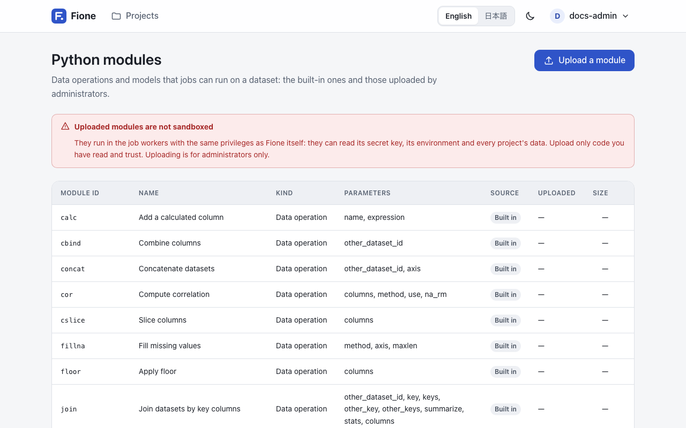

# Python modules for data operations

A **Python module** is a data operation that runs as a job on the server: it takes a dataset and a few parameters and produces a new dataset. Fione comes with built-in modules for common table operations (joins, reshaping, calculated columns, values from earlier times, rolling statistics, ranks), k-means clustering and low-rank factorization, and administrators can upload their own.

A module never changes its input. Its result is saved as a new dataset in the same project, so you can inspect it, train on it or feed it to another module.

## Where to find them

Open the account menu and choose **Python modules**. Administrators always see this entry; other users see it when the view is set to **Detailed** (the **View** switch in the same menu). The page lists every module with its id, name, kind, parameters, source (**Built in** or **Uploaded**) and, for uploaded ones, its size and when it was uploaded.



Everyone who can sign in can see the list. Running a module needs write access to the project, and uploading or deleting one needs the administrator role.

Modules run as jobs through the [Python client](/guide/sdk), the [REST API](/docs/rest-api) or an [MCP client](/guide/mcp); the page itself is the catalogue. The assistant can also propose a join for you to confirm (see [The assistant](/guide/assistant)).

## Kinds of modules

| Kind | Label on the page | What it does |
|---|---|---|
| `frame` | Data operation | Turns a dataset into another dataset. |
| `train` | Trains a model | Turns a dataset into a new dataset **and** saves a small trained state, which Fione calls a module model. |
| `predict` | Predicts | Applies the state of a module model to a dataset. It takes the id of that state in `module_model_id`. |

The result of a `predict` module is saved as a dataset of type `predict`; the result of the others is saved as a `train` dataset. Unless you give a `name`, the new dataset is called `<module id>_<input dataset name>`.

## Built-in modules

### Data operations

| Id | Name | What it does |
|---|---|---|
| `cbind` | Combine columns | Puts the columns of a second dataset (`other_dataset_id`) beside the columns of the first. Both need the same number of rows. |
| `rbind` | Combine rows | Stacks the rows of a second dataset (`other_dataset_id`) under the first. Both need the same set of columns, in any order. |
| `concat` | Concatenate datasets | Combines two datasets side by side (`axis` 1, the default) or one under the other (`axis` 0; a column only one of them has is left empty in the other's rows). |
| `join` | Join datasets by key columns | Adds the columns of the other dataset to the rows with the same key. Every row of the first dataset stays. See [Joining](#joining). |
| `cslice` | Slice columns | Keeps the listed `columns`. |
| `rslice` | Slice rows | Keeps the rows that match `row_conditions`. |
| `replace` | Replace values | Sets `column` to `value` in the rows that match `row_conditions` (all rows if empty). |
| `sort` | Sort | Sorts by `column` (`ascending`, `true` by default). Empty values go last. |
| `fillna` | Fill missing values | Fills gaps from the previous value (`method` `forward`, the default) or the next one (`backward`), down the columns (`axis` 0) or across a row (`axis` 1), filling at most `maxlen` missing cells in a row (default 1). |
| `floor` | Apply floor | Returns only the numeric `columns`, rounded down. |
| `cor` | Compute correlation | The correlation matrix of the numeric `columns` (`method` `pearson` or `spearman`). |
| `pivot` | Pivot table | One row per value of `index`, one column per value of `column`, filled from `value`. See [Reshaping](#reshaping). |
| `unpivot` | Unpivot columns into rows | Turns columns into rows: one row per input row and column. See [Reshaping](#reshaping). |
| `calc` | Add a calculated column | Adds the column `name`, computed by `expression` from other columns. See [Calculated columns](#calculated-columns). |
| `lag` | Add values from earlier times | Adds the values of `columns` at earlier times of `time`. See [Time and order](#time-and-order). |
| `rolling` | Add statistics of nearby values | Adds statistics of `columns` over the rows before, around or after each row in `order`. See [Time and order](#time-and-order). |
| `rank` | Add the rank within a group | Adds the rank of `column` within each group of `by`. See [Time and order](#time-and-order). |
| `split` | Split into train, valid and test | Returns one `part` (`train`, `valid` or `test`) of a random split by `train_ratio`, `valid_ratio`, `test_ratio` (relative weights, 70, 15 and 15 by default) and `seed`. Rows keep their order. |
| `tokenize` | Tokenize text | Splits a text column (`target_column`) into one token per row, with an empty row after each document. `mode` is `word` (runs of letters, digits and `_`; the default), `whitespace` or `delimiter` (with `delimiter`). |

`row_conditions` is a text such as `age >= 30 & country == JP`: terms of the form `column operator value` (operators `==`, `!=`, `<`, `<=`, `>`, `>=`, with a space on each side) or `column is empty` / `column is not empty`, joined by `&` (and) and `|` (or); `&` binds tighter. Parentheses are not supported, and a value cannot contain `&` or `|`. An empty cell never matches a comparison, not even `!=`. An empty text matches every row.

The modules that compute with columns (`calc`, `lag`, `rolling`, `rank`, `floor`, `cor` and the clustering modules below) need integer or float columns (booleans count as 1 and 0 in `calc`); the job fails and names a text or date column. Column names and types are checked when the job runs.

#### Joining

`join` matches the key in the first dataset with the key in the other one. Name one key column in `key`, or several that identify a row together in `keys`; in the other dataset, `other_key` or `other_keys` (the same names if both are empty). A row whose key is empty matches nothing, and a number key matches the same text (`7` matches `"7"`).

Each key may appear only once in the other dataset. If it appears more than once, set `summarize` to `true`: the other dataset is then reduced to one row per key, with the number of rows (`rows`), for each numeric column the statistics in `stats` (from `mean`, `min`, `max`, `sum`, `std` and `last`, the last value in row order; `mean,min,max,sum` by default), and for other columns the number of different values. With `columns`, only those columns of the other dataset are added or summarized. The job reports how many rows found no match.

#### Reshaping

`pivot` takes `index`, `column` and `value`. When a cell gets more than one row, `agg` decides what it holds: `first` (the default; the job reports how many cells had more), `sum`, `mean`, `min`, `max` or `count`. Rows with an empty `index` or `column` are left out.

`unpivot` keeps the `keep` columns on every row and turns the other columns (or only those in `columns`) into two columns: `name` (default `variable`) with the column name and `value` (default `value`) with its value.

#### Calculated columns

`calc` adds the float column `name` (which must not exist yet) from `expression`, for example `price * quantity` or `where(age >= 65, 1, 0)`:

- Column names are written as they are; a name with spaces or symbols, or one that is not a plain word, is written `col("unit price")`.
- Arithmetic `+ - * / **`; comparisons `== != < <= > >=` and logic `&`, `|`, `~` give 1 or 0. Put each comparison in parentheses before joining it with `&` or `|`.
- Functions: `abs`, `sqrt`, `log`, `log1p`, `exp`, `floor`, `sin`, `cos`, `radians`, `min2(a, b)`, `max2(a, b)`, `mod2(a, b)`, `atan2(y, x)`, `clip(x, lo, hi)`, `isnull(x)`, `where(cond, x, y)` and the constant `nan`.
- Row functions `rowsum`, `rowmean` and `rowcount` take values and quoted name patterns, such as `rowsum("score_*")`, and skip empty values.

A result that comes out infinite (division by zero, `log(0)`) is left empty, and the job reports how many rows that happened in.

#### Time and order

`lag` adds `<column>_lag<k>`: the value of each of `columns` `k` steps of `time` earlier, for each `k` in `lags` (comma-separated, `1` by default), within each group of `by`. `time` holds whole numbers, numbers `step` apart, or dates (one step is a day, so weekly data uses `step` 7). Rows of a group with the same time are first reduced to their `mean` or `sum` (`how`). The value is empty when no row has that earlier time, and the job reports a lag column that is empty on nearly every row.

`rolling` adds `<column>_<side><window>_<stat>` (or `<column>_<side>_span<span>_<stat>`) for each of `columns`, ordered by `order` (numbers or dates) within each group of `by`:

- `window` counts rows, or `span` counts the distance in `order` (days for dates); give exactly one of them.
- `side` is `before` (the earlier rows, not the row itself; the default), `after` (the later rows) or `around` (an odd `window` centred on the row, which is included). `after` and `around` read later rows, so they do not suit forecasting.
- `stats` is a comma-separated list from `mean`, `std`, `min`, `max`, `sum` and `count` (`mean` by default).

`rank` adds `<column>_rank`, a percentile from 1/n to 1 (`how` `percent`, the default), or `<column>_dense_rank`, 1, 2, 3 with ties sharing a rank (`how` `dense`), within each group of `by`. With `among`, each group of `among` is first reduced to its mean and ranked as one.

### Clustering and low-rank factorization

These come as pairs: a `train` module learns from a dataset, and a `predict` module applies what it learned to any dataset with the same columns.

| Id | Name | Main parameters |
|---|---|---|
| `kmeans_train` | K-means (train) | `columns` (all columns if empty; each must be numeric), `k` (default 3), `init`, `max_iterations`, `standardize` (default `true`), `seed`, `output_columns` |
| `kmeans_predict` | K-means (assign clusters) | `module_model_id` (a state from `kmeans_train`), `output_columns` |
| `lowrank_train` | Low-rank projection (train) | `columns`, `method` (`svd` or `nmf`), `n_components` (default 2), `seed`, `output_columns` |
| `lowrank_predict` | Low-rank projection (project) | `module_model_id` (a state from `lowrank_train`), `output_columns` |

K-means adds a `cluster` column (numbered from 0); the low-rank modules add `component_1`, `component_2` and so on. The result holds only those columns, plus the input columns named in `output_columns`. Missing values are replaced by the column mean seen in training. Every chosen column must be an integer or float column (not text, a date or a boolean), or the job fails and names the offending columns, so list the numeric ones in `columns`. `nmf` needs values of 0 or more. A `predict` module accepts only a state of its own `train` module from the same project.

Each module's full parameter list, with types, defaults and limits, is what `GET /api/v1/modules` returns.

## Run a module

Running a module is a job. With the [Python client](/guide/sdk):

```python
from fione_sdk import Client

fione = Client()
job = fione.run_module(
    "<project-id>", "sort", dataset_id, {"column": "age"}, name="sorted by age"
)
job.wait()
sorted_frame = fione.read("<project-id>", job.result["dataset_id"])
```

With the [REST API](/docs/rest-api), `POST /api/v1/projects/<project-id>/jobs/module` takes the module, the dataset and its parameters:

```sh
curl -X POST http://localhost:8080/api/v1/projects/<project-id>/jobs/module \
  -H "Authorization: Bearer <your-token>" \
  -H "Content-Type: application/json" \
  -d '{"module_id": "sort", "dataset_id": 1, "params": {"column": "age"}}'
```

When the job is done, `result.dataset_id` is the new dataset. A `train` module also returns `result.module_model_id`, which you pass as `module_model_id` to the matching `predict` module:

```python
train = fione.run_module(
    project_id, "kmeans_train", train_id, {"k": 3, "columns": ["sepal_length", "sepal_width"]}
).wait()
clusters = fione.run_module(
    project_id, "kmeans_predict", new_rows_id, {"module_model_id": train.result["module_model_id"]}
).wait()
```

Parameters are checked before the job is queued: an unknown parameter name, a missing required one, a value of the wrong type or out of range, or a dataset or module model of another project is refused right away. Column names and types are checked when the job runs. Some modules add notices to the finished job, such as how many rows found no match in a join. Jobs run in the short-job queue (`FIONE_MAX_CONCURRENT_SHORT_JOBS` at once) and read the whole dataset into memory.

## Upload your own module (administrators)

A module is one Python file of up to 256 KB, in UTF-8. It defines two things: `MODULE`, a dict that describes it, and `run(df, params, ctx)`, the function that does the work.

```python
# sepal_area.py
MODULE = {
    "name": "Add sepal area",
    "kind": "frame",
    "params": {
        "properties": {
            "scale": {"type": "number", "default": 1.0},
        },
        "required": [],
    },
}


def run(df, params, ctx):
    return df.assign(sepal_area=df["sepal_length"] * df["sepal_width"] * params["scale"])
```

### `MODULE`

`MODULE` needs all three keys.

| Key | Meaning |
|---|---|
| `name` | The name shown on the page (a longer one is shortened to 100 characters). |
| `kind` | `"frame"`, `"train"` or `"predict"`. |
| `params` | The parameters, as `{"properties": {...}, "required": [...]}`. Each property has a `type`, and can have `default`, `description`, `enum`, `minimum`, `maximum`, `maxLength`, `maxItems` and `items`. |

A parameter `type` is `string`, `integer`, `number`, `boolean` or `array` (an array of strings). Nothing else is accepted, so a module cannot take nested objects. Fione validates the parameters of every job against this description and fills in defaults before `run` is called.

Two parameter names have a meaning, and must be integers:

- `other_dataset_id`: `ctx.other` is then that dataset, as a second frame.
- `module_model_id`: `ctx.state` is then the state saved by a `train` module. A `predict` module must declare it.

### `run(df, params, ctx)`

- `df` is the input dataset as a pandas DataFrame.
- `params` is the validated parameters, with defaults filled in.
- `ctx` has `other` (the second dataset, or `None`) and `state` (the saved state, or `None`).
- A `frame` or `predict` module returns a DataFrame. A `train` module returns a pair `(DataFrame, state)`, where `state` is a JSON object (a dict of text, numbers, booleans, lists and dicts) of at most 8 MB. There is no pickling: a state is plain JSON, so loading one cannot run code.

The returned DataFrame needs at least one column, with unique text column names, and at most 150 million cells (rows times columns). If `run` raises an exception, the job fails and its message names the exception; file paths are removed from the message.

A train and predict pair looks like this:

```python
# column_mean_train.py
MODULE = {
    "name": "Column mean (train)",
    "kind": "train",
    "params": {
        "properties": {"column": {"type": "string"}},
        "required": ["column"],
    },
}


def run(df, params, ctx):
    column = params["column"]
    return df, {"column": column, "mean": float(df[column].mean())}
```

```python
# column_mean_apply.py
MODULE = {
    "name": "Center on the column mean",
    "kind": "predict",
    "params": {
        "properties": {"module_model_id": {"type": "integer"}},
        "required": ["module_model_id"],
    },
}


def run(df, params, ctx):
    column, mean = ctx.state["column"], ctx.state["mean"]
    return df.assign(**{column + "_centered": df[column] - mean})
```

### Upload it

In the web app, open **Python modules**, choose **Upload a module**, enter a **Module id**, pick the **Python file (.py)**, tick the confirmation that you understand the code runs unsandboxed, and choose **Upload the module**. The id has 1 to 40 characters: lower-case letters, digits and `_`, starting with a letter. It cannot be the id of a built-in module or of a module that already exists.

Through the API, upload the file as a multipart form with the fields `id` and `file`:

```sh
curl -X POST http://localhost:8080/api/v1/modules \
  -H "Authorization: Bearer <your-token>" \
  -F id=sepal_area \
  -F file=@sepal_area.py
```

Fione reads `MODULE` by importing the file once in a short-lived separate process (it must load within 10 seconds, so keep top-level code quick), then checks the description. A file with a syntax error, a missing `MODULE` or `run`, an unknown `kind`, or a `predict` module without an integer `module_model_id` is refused with a message.

To replace a module, delete it first and upload it again. Deleting a module (**Delete** next to it on the page, or `DELETE /api/v1/modules/<module-id>`) also deletes the states it trained; datasets and finished jobs keep their results. Built-in modules cannot be deleted.

::: warning Uploaded modules are not sandboxed
An uploaded module runs in the job worker with the same privileges as Fione itself. It can read the install's secret key, its environment and every project's data. Upload only code you have read and trust. This is why only administrators can upload modules, after confirming a warning. Built-in modules are not affected.
:::

A job that is still waiting when you replace a module runs the new source, not the one that was current when the job was queued. See [Known limitations](/docs/known-limitations) for this and the other notes on modules.
