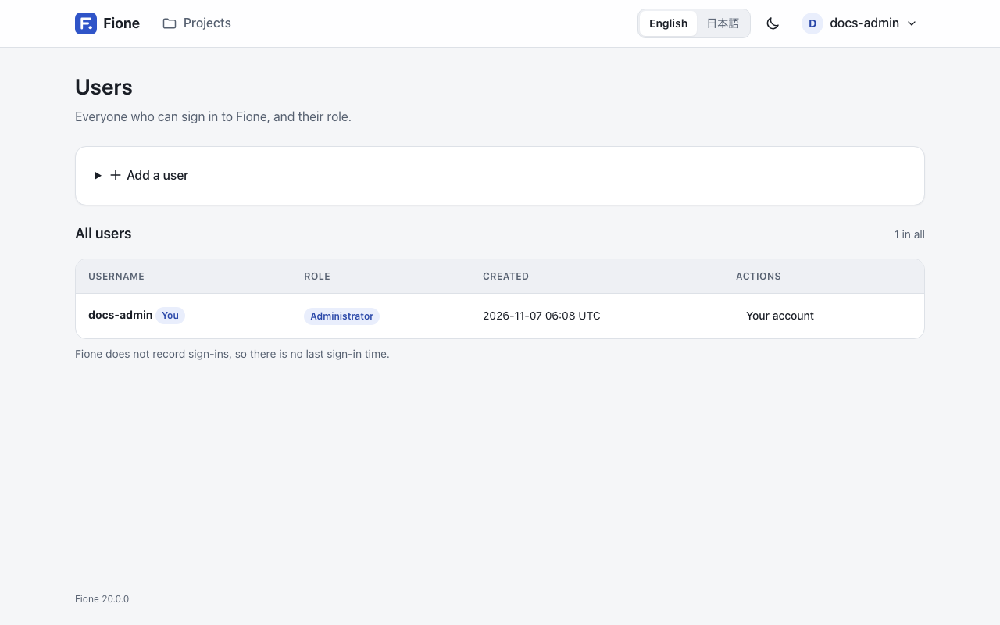
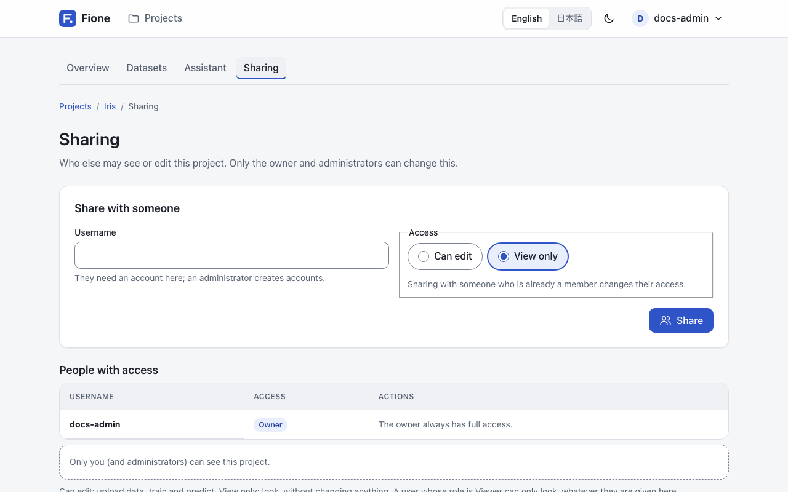
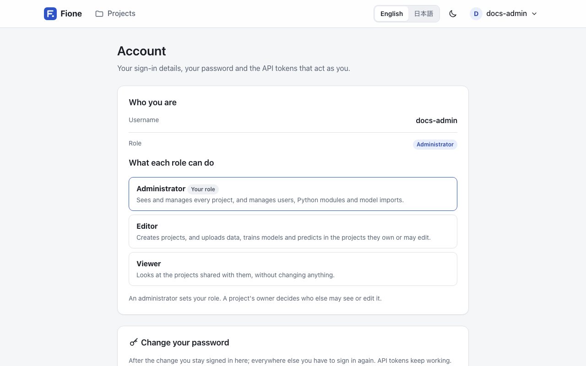

# Users, roles and sharing

Fione is a multi-user server. Administrators create the accounts, every account has a **role**, and every project is shared **per user**. This page explains who can do what, and how to manage users, sharing and API tokens.

## Roles

Every user has one of three roles, set by an administrator.

| Role | What the person can do |
|---|---|
| **Administrator** | Sees and manages every project, and acts as the owner of each one. Manages users, Python modules and model imports, and sees the System status page. |
| **Editor** | Creates projects. In the projects they own or that are shared with them as **Can edit**, uploads data, trains models and predicts. |
| **Viewer** | Looks at the projects shared with them, without changing anything. Cannot create projects. |

A shorter version is shown to each person on the **Account** page, under "What each role can do".

## Project access

A role says what a person may do in general. Each project then says who may use it:

| Access | Who | What it allows |
|---|---|---|
| **Owner** | The person who created the project, and every administrator | Everything in the project, including sharing it and deleting it. |
| **Can edit** | Users the owner shared the project with | Upload data, train, predict, and delete datasets, models and jobs of the project. |
| **View only** | Users the owner shared the project with | Look at the project. |

Three rules combine the two:

- **A project nobody shared is private.** Only its owner and the administrators see it.
- **A Viewer can only look**, whatever access a project gives them. A Viewer who is shared a project as **Can edit** still cannot change it. If an Editor who owns projects is later made a Viewer, those projects become read-only for them too.
- **Looking includes downloading.** Anyone with at least View only access can open datasets, charts and explanations, download datasets as CSV, and download a model's export or serving bundle. Importing a model file is for administrators only.

## Sign in for the first time

A new installation has no users. The first administrator is created on the setup page with the setup token that Fione prints to its log when it starts, or with the value of `FIONE_SETUP_TOKEN` if you set it. The steps are in [Installation and quick start](/guide/installation). After that, the token is no longer accepted, and every other account is created by an administrator.

People sign in with a username and a password:

- A username is 1 to 64 characters: letters, digits, dot (`.`), underscore (`_`) and hyphen (`-`).
- A password has at least 8 characters.
- There is no self-service password reset. The sign-in page says: "Forgot your password? Ask an administrator to reset it."
- A sign-in lasts 7 days by default (`FIONE_SESSION_MAX_AGE_SECS`). After 5 failed attempts for the same username from the same address within 15 minutes, further attempts are refused for a while (`FIONE_LOGIN_MAX_FAILURES`, `FIONE_LOGIN_WINDOW_SECS`). See [Configuration](/docs/configuration) for both settings.

To change your own password, open the **Account** page from the account menu and use "Change your password". It asks for your current password. After the change you stay signed in on that browser, every other sign-in of yours ends, and your API tokens keep working.

## Manage users (administrators)

Open the account menu and choose **Users**. Only administrators see this entry.



| To | Do this |
|---|---|
| Add a user | Under "Add a user", enter a username, a password and a role, then choose **Add user**. Give the person their username and password; they can change the password on their Account page. |
| Change a role | In the user's row, pick the new role and choose **Save**. It applies from that person's next request. |
| Set a new password | Choose **New password** next to the user, enter the password and choose **Set password**. Their sign-ins end and they sign in with the new password. Their API tokens keep working. |
| Delete a user | Choose **Delete** next to the user and confirm. Their API tokens and project memberships are deleted with them. |

Fione protects itself from lock-outs and from orphaned data. It refuses to:

- remove or demote the last administrator: make someone else an administrator first;
- let you give up your own administrator role, or delete your own account: another administrator has to do it;
- set a new password for yourself on this page: use your own **Account** page;
- delete a user who still owns projects or jobs: delete those first. An administrator can delete any project with **Delete project** on the project's page.

## Share a project

Only the project's owner and administrators can change who has access.



1. Open the project. In its **Sharing** section, choose **Manage sharing**.
2. Under "Share with someone", enter the person's username. They need an account on this server, so ask an administrator to create one first.
3. Choose the access, **Can edit** or **View only**, then choose **Share**.

To change someone's access, share the project with them again and pick the other level. To stop sharing, choose **Remove** next to the person and confirm: they no longer see the project, and what they created in it stays. The owner is not listed and cannot be shared with; the owner always has full access.

::: tip
Deleting a project removes its datasets, models, jobs and predictions for good, and the people it was shared with lose access. Running and queued jobs are stopped first.
:::

## API tokens

A script can use Fione's [REST API](/docs/rest-api) or the [Python client](/guide/sdk) with an **API token** instead of a password. A token acts as you, with your role and your projects: anyone who has it can do what you can.



To create one, open the **Account** page and go to "API tokens":

1. Enter a name that says what will use the token, for example `nightly report`.
2. Choose **Create token**.
3. Copy the token right away. It is shown only once, and Fione stores only a hash of it.

Send it as a bearer token:

```sh
curl -H "Authorization: Bearer <your-token>" http://localhost:8080/api/v1/auth/me
```

The answer names the user the token belongs to and its role.

To stop a token from working, choose **Revoke** next to it and confirm. Scripts that use it fail at once, and this cannot be undone. Keep in mind that:

- tokens do not expire, and Fione does not record when one was last used, so revoke the ones you no longer need;
- setting a new password for a user does not revoke their tokens; revoke them as well if an account may be compromised;
- deleting a user deletes their tokens.

See [Known limitations](/docs/known-limitations) for the security notes that apply to accounts, tokens and Python modules.
