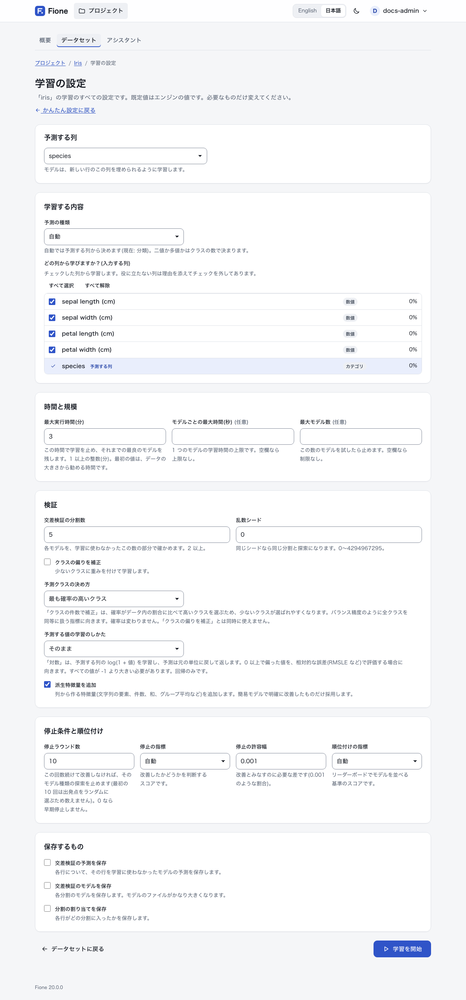
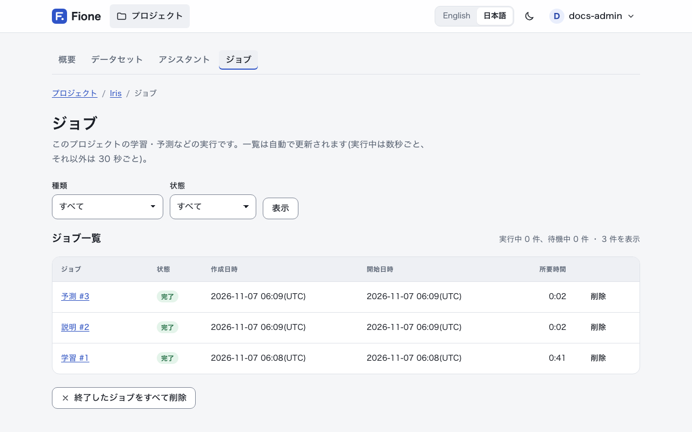

# AutoML 画面

Fione の詳細表示は、すべてを見て、すべてを設定したい人のための画面です。全列の統計とグラフ、すべての学習設定、ジョブ一覧、リーダーボード付きのモデル一覧、モデルのエクスポートとインポートがあります。機械学習が初めてなら、まず [EasyML ウィザード](/ja/guide/easyml) から始めてください。ウィザードでできることは、ここでもすべてできます。

## 詳細表示に切り替える {#detailed-view}

アカウントのメニュー(右上のユーザー名)を開き、**表示**で**詳細**を選びます。この設定はブラウザごとに記憶されます。変わるのは画面の表示だけで、できる操作は変わりません。どちらの表示でも、ロールと権限は同じです。

詳細表示では、プロジェクトのメニューに、**概要**・**データセット**・**アシスタント**に加えて**モデル**と**ジョブ**が表示されます。プロジェクトの所有者には**共有**も表示されます([ユーザーと共有](/ja/guide/users-sharing) を参照)。データセットには**このデータセットで学習**ボタンが加わり、すべての学習設定の画面が開きます。

## データを確認する {#data-analysis}

プロジェクトの**データセット**を開きます。**データセットをアップロード**で CSV をアップロードし、**データの種類**を選びます。

- **学習データ**には、予測する列があります。
- **予測するデータ**には、予測する列がありません。
- **予測結果**は、保存しておく結果です(バッチ予測が自動で作ります)。

データセットを開くと、4 つのタブがあります。

**データ概要**には、行数、列数、空のセルの割合、保存サイズと、種類ごとの列数が表示されます([列の種類](#column-kinds)を参照)。各列の詳細は、データの先頭の行から求めています。セル数でおよそ 200 万個分、500〜50,000 行です(列が多いデータでは行数が少なくなります)。サンプルを使ったときは、何行から求めたかがタブに表示されます。

**列**には、すべての列が 1 ページ 100 列ずつ表示されます。種類、空の値の割合、値の種類の数、数値の最小・平均・最大、最頻値、注記が分かります。注記には、Fione が既定で予測する列として選んだ列(ID らしい列と値が 1 種類の列を除いた最後の列)と、その列を基準に答えを教えてしまうおそれのある列が示されます([リークの警告](/ja/guide/explanations#leak-warnings)を参照)。列名を押すと、その列のページが開きます。

**データ**には、保存されている値が、保存されているとおりの文字で表示されます。一度に最大 200 行・50 列で、行と列を移動するボタンがあります。

**相関**には、相関の強い数値列の組を上位 20 件、グラフと表で表示します。相関係数(r)はピアソンの相関係数で、-1〜1 の値です。1 や -1 に近いほど 2 つの列が一緒に増減し、0 に近いほど関係がありません。両方の列に値がある行が 10 行以上ない組は求めません。数値の列が 2 つ未満のときは、比べるものがありません。

### 1 つの列 {#column-page}

列のページには 2 つのカードがあります。**分布**は、数値の列では 20 区間のヒストグラム、そのほかの列では多い値 10 個の棒グラフです(残りは「その他の値」にまとめます)。**統計**には、値のある行数、空の割合、値の種類の数が並び、数値の列では平均、標準偏差、最小、第 1 四分位数、中央値、第 3 四分位数、最大も表示されます。数値の列には外れ値の割合も示します。外れ値は、中央の半分の範囲から、その幅の 1.5 倍より大きく離れた値です。統計とグラフは、ほかのタブと同じ先頭の行から求めています。

### 列の種類 {#column-kinds}

Fione は各列の内容を判定します。この種類によって表示が変わり、どの列を入力する列から外すかも決まります。

| 種類 | 意味 |
|---|---|
| 数値 | 数値です。コードや ID ではない整数も含みます。 |
| カテゴリ | 真偽値、小さな整数のコード(値の種類が 10 以下で、行数の 5% 以下)、値の種類が少ない文字列(50 種類以下、または行数の半分以下)です。 |
| テキスト | カテゴリではない文字列のうち、平均の長さが 30 文字を超えるもの、または値の種類が 1,000 を超えるものです。 |
| 日付 | 日付型の列と、値の 95% 以上が日付として読め、半分以上に年・月の名前・時刻が含まれる文字列の列です。 |
| ID らしい | すべての値が異なる整数または文字列の列です(20 件以上)。予測の役に立ちません。 |
| 値が 1 種類 | すべての行で同じ値の列です。予測の役に立ちません。 |

## 学習の設定 {#training-settings}

データセットのページで**このデータセットで学習**を押します(学習データのみ。編集権限が必要です)。**学習の設定**のページに、すべての設定が表示されます。既定値はエンジンの値です。必要なものだけ変えてください。**かんたん設定に戻る**で、[ウィザード](/ja/guide/easyml)のデータ分析に戻れます。

最上部の**予測する列**で、予測する列を選びます。変えると、その列でページが読み込み直されます。注意が必要なときは、フォームの上にお知らせが出ます。予測する列がこのままでは学習できない場合(行が少なすぎる、空の値がある、値が 1 種類しかない、回帰なのに文字が入っている、クラスが多すぎる、1 行しかないクラスがある)や ID のように見える場合、答えを教えてしまうおそれのある列がある場合、勧める実行時間、偏った値や少ないクラスに向く設定のヒントです。

### 学習する内容

- **予測の種類**: **自動**は予測する列から決めます。判定結果はフォームに表示されます。**分類(二値・多値)** か **回帰** を選ぶと、それに従います。二値か多値かはクラスの数で決まります。
- **どの列から学びますか？(入力する列)**: チェックした列が入力する列です。役に立たない列は、理由を添えてチェックが外されます。ID らしい列、値が 1 種類の列、答えのコピーの列、値で答えが決まる列です。その列だけで答えを不自然なほどよく当てる列は、警告付きでチェックされたままになります。各行には、列の種類と空の割合も表示されます。**すべて選択**と**すべて解除**で、すべてのチェックボックスを切り替えられます。

### 時間と規模

- **最大実行時間(分)**: この時間で学習を止め、それまでの最良のモデルを残します。1 以上の整数(分)です。最初の値は、データの大きさから勧める時間(3・10・30 分のいずれか)で、同じ内容がお知らせにも表示されます。学習はこれより早く終わることがあります。探索と最終のリフィットで時間が余る場合があり、後述のほかの上限で終わる場合もあります。
- **モデルごとの最大時間(秒)**: 1 回の試行の学習時間の上限です。空欄なら上限なしです。すべての分割を学習できないほど短い値は、引き上げられ、お知らせが出ます。
- **最大モデル数**: すべてのモデル種類を通して、この回数の試行をしたら探索を止めます。空欄なら制限なしです。

### 検証

- **交差検証の分割数**: 各モデルを、学習に使わなかったこの数の部分で確かめます。2 以上で、既定は 5 です。データが小さいときは、お知らせを出して減らします。最も少ないクラスの行数と、行数の 5 分の 1 のうち小さいほうまでです(2 未満にはなりません)。
- **乱数シード**: 同じシードなら同じ分割と探索になります。0〜4294967295 で、既定は 0 です。
- **クラスの偏りを補正**: 少ないクラスに重みを付けて学習します。回帰では無視されます。
- **予測クラスの決め方**: [予測クラスの決め方](#choosing-the-predicted-class)を参照してください。
- **予測する値の学習のしかた**: [偏った値の学習](#skewed-target)を参照してください。
- **派生特徴量を追加**: 既定でオンです。[派生特徴量](#derived-features)を参照してください。

### 停止条件と順位付け

- **停止ラウンド数**: このラウンド数続けて改善しなければ、そのモデル種類の探索を止めます。最初の 10 回(出発点をランダムに選ぶ試行)は数えません。0 なら早期停止しません。既定は 10 です。
- **停止の指標**: 改善したかどうかを判断するスコアです。**自動**は、分類では対数損失、回帰では RMSE です。
- **停止の許容幅**: 改善とみなすのに必要な差で、割合です(既定は 0.001、つまり 0.1%)。
- **順位付けの指標**: モデルのリーダーボードで順位を付ける基準のスコアです。**自動**は、停止の指標と同じです。

分類で選べる指標は、**対数損失(分類)**、**AUC(二値分類)**、**正解率(分類)** です。回帰では、**RMSE(回帰)**、**MAE(回帰)**、**決定係数 R²(回帰)** です。予測の種類に合わない指標は受け付けません。

### 保存するもの

3 つとも、既定ではオフです。**交差検証の予測を保存**は、各行について、その行を学習に使わなかったモデルの予測を保存します。**交差検証のモデルを保存**は、各分割のモデルを保存します。モデルのファイルがかなり大きくなります。**分割の割り当てを保存**は、各行がどの分割に入ったかを保存します。

### 開始する

**学習を開始**を押します。問題があるときは、メッセージ付きでフォームに戻り、何も実行されません。問題がなければジョブのページが開き、進行状況が表示されます([ジョブ](#jobs)を参照)。

### 実行時間の使われ方

エンジンは、最大実行時間を段階に分けて使います。最初に派生特徴量を選びます(時間の 10% まで。短い実行では 30 秒、ただし実行時間の 30% を超えません)。次に探索で、残りの時間の約 65% を使います。モデル種類は順に実行します(LightGBM、文章を含むデータでは TextLinear、CatBoost、XGBoost、RandomForest、ExtraTrees、DeepLearning、Linear)。各種類は、その時点で残っている探索時間の一部を受け取るので、ある種類が使い残した時間は次の種類に回ります。探索は Optuna で調整し、各試行を交差検証の分割で採点します。次に、良い試行をアンサンブルに組み合わせ、そのメンバーを全行で学習し直します。まだ時間が残っていれば、いちばん良いブースティングとフォレストのメンバーを、別のシードで学習し直して予測を平均します。モデルの保存用に、予備の時間も確保します。

サイズの上限が 2 つあります。モデルが 40 MiB を超えるメンバーは外し、全メンバーの合計は 90 MiB 以下に収めます。Linear、TextLinear、DeepLearning は、データを one-hot エンコードしたコピーを使います。そのコピーが 1 億セル(コピーの行数 × 列数)を超えるときは、実行から外し、お知らせを出します。

## 予測クラスの決め方 {#choosing-the-predicted-class}

分類モデルは、確率がいちばん大きいクラスを予測します。あるクラスがほかよりずっと少なく、評価の指標が全クラスを同等に扱う場合(バランス精度、マクロ再現率など)は、**予測クラスの決め方**を**クラスの件数で補正**にします(API では `decision: "balanced"`)。予測ラベルは、学習データ内の割合に比べて確率がいちばん大きいクラスになるので、少ないクラスが選ばれやすくなります。確率は変わりません。学習結果の正解率と混同行列、バッチ予測、Fione Serving、説明も、同じ決め方に従います。

学習中に同じ偏りを補正する**クラスの偏りを補正**とは同時に使えません。回帰では無視されます。少ないクラスの割合が小さいときは、学習の設定のページにヒントが表示されます。既定の**最も確率の高いクラス**は、確率が最大のクラスを選びます。

## テキストの列 {#text-columns}

文章の列(値の中央値が 5 語以上)は、2 通りに読まれます。1 つは話題で、派生特徴量になります(後述)。もう 1 つは、TextLinear というモデル種類が単語を読みます。単語と単語の組の TF-IDF の重みで、ロジスティック回帰(または Ridge 回帰)を行い、ほかの列も一緒に入れて、学習の分割ごとに学習し直します。このような列があるデータでだけ探索とアンサンブルに加わり、予測はほかのモデル種類の予測と、同じ交差検証のスコアで混ぜます。

その派生として、3 つの*後発候補*があります。

- **TextLinearWide**は、列ごとに最大 100,000 個の単語と単語の組を使います。
- **TextLinearChar**は、単語に加えて 2〜5 文字の文字 n-gram も読みます。文章がとても大きいとき(約 500 万文字以上)や、空白のない文章では使いません。
- **TextLinearPlain**は、派生特徴量なしで学習します。派生特徴量が採用されたときだけ試します。

これらは、ほかのモデル種類がすべて終わったあと、残った探索時間で実行します。文章のあるデータでは、探索時間の 15% をこのために確保し(TextLinear 以外のモデル種類から取り分けます)、ほかのモデル種類が使い残した分を加えます。各候補はその時間の一部を受け取り、自分の取り分で最初の試行を終えられない候補は飛ばします。後発候補がモデルに残るのは、交差検証のスコアでアンサンブルが良くなるときだけです。そうでなければ重み 0 で外れます。文章の列のないデータでは実行しません。

値が 200 種類を超える文字列の列は、モデルには、各値の出現頻度として読まれます。詳しくは[既知の制限](/ja/docs/known-limitations)を参照してください。

## 偏った値の学習 {#skewed-target}

0 以上で偏った値(価格、件数、所要時間など)を予測する回帰で、RMSLE のような相対的な誤差で評価する場合は、**予測する値の学習のしかた**を **対数(log1p)** にします(API では `target_transform: "log1p"`)。Fione は log(1 + 値) を学習し、予測は元の列の単位に戻して返します。モデルのスコア、診断、リーダーボード、バッチ予測、Fione Serving、説明は、すべて元の単位です。説明では、バイアスから予測までの変化を、対数に対する各列の効果の比で配分するため、近似になります。探索そのもののスコア(スコア履歴)だけは、対数の尺度のままです。

すべての値が -1 より大きい必要があり、分類では無視されます。値が 0 以上で偏っているときは、学習の設定のページにヒントが表示されます。

## 派生特徴量 {#derived-features}

**派生特徴量を追加**(API では `feature_engineering`、既定でオン)をオンにすると、Fione は列から、目的変数を読まない特徴量を作り、検証で採用するものを選びます。

- **テキストの列**: よく出る語(文字の連なり。`C85` は `c` になります)の 0/1 フラグ、長さ、語数、数字と大文字の割合、最初の数値です。文章の列(中央値が 5 語以上)では、さらに 32 個の*話題*(TF-IDF の重みを SVD で分解した、語の使われ方の主な方向)も作ります。
- **カテゴリ**: 各値の出現頻度と、値の組の出現頻度です。
- **識別子**: 値の種類が 12 以上で空白のない文字列の列(最大 2 列)で、値(欠損を除く先頭 1,000 件で判定)の 95% 以上が `_`、`/`、`-`、`:`、`.` で同じ数の 2〜4 個の項目に分かれるもの(`0001_01`、`B/0/P`)は、項目ごとに特徴量を作ります。数値の項目はその数値、そうでなければ値の出現頻度です。さらに、最初の項目を共有する学習行の数(グループの大きさ)も作ります。学習で見なかった値は、0 ではなく欠損になります。このグループは最後に試します。
- **行**: 欠損値の数と 0 の数です。
- **日付**: 時、分、週、四半期、年内の通算日、週末かどうか、日付の列どうしの差(秒)です。
- **数値**: 最も役に立つ数値の列のいくつかの和・差・積・比、最も役に立つ小さなカテゴリ 3 つそれぞれでの平均(と、それとの差)、繰り返し現れる値の出現頻度、k-means のクラスターとクラスター中心までの距離です。

日付の特徴量には日付の列が必要です。`25-12-2024 09:00` や `Mar 5, 2024` のような日付の文字列も日付として認識します。最初の項目に 12 を超える値があり、2 番目の項目にはない場合は日が先、そうでなければ月が先として読みます(`02-10-2012` は 10 月 2 日になります)。このオプションとは別に、線形モデルとニューラルネットワークは、強く偏った 0 以上の数値を対数変換します。

各グループは、最大 2 万行のサンプルで小さな LightGBM を使って試し、対応のある交差検証の分割で損失が標準誤差の 3 倍を超えて、かつ平均で 0.1% 以上下がり、70% 以上の分割で改善したときだけ採用します。採用したグループ全体は、同じ行の別の分割による最後の確認も通る必要があります。そのため、1 つも採用されないこともあります。ジョブが終わったあと、ジョブのページの**詳細を見る**に、採用したグループ(または「none added」)を知らせる通知が表示されます([ジョブ](#jobs)を参照)。

## ジョブ {#jobs}

学習、バッチ予測、説明、モデルのエクスポート、Python モジュールは、すべてサーバー上のジョブとして実行されます。ジョブのページを離れても、実行は続きます。

ジョブのページには、状況、進行状況のバー、経過時間、残り時間(最大)が表示されます。学習では、試したモデル数と、これまでの最小誤差(学習に使わなかった行で測ります。小さいほど良い値です)も表示されます。表示は自動で更新されます。**学習を中止**(ほかの種類では対応するボタン)を押して確認すると、ジョブを止めます。止めた学習ではモデルは保存されません。完了すると、結果のページに移動します。学習なら、新しいモデルの予測結果サマリーです。あとで学習したモデルのジョブのページを開くには、モデルのページの**概要**タブにある**学習ジョブ**のリンクを使います。失敗したジョブにはメッセージが表示され、終了後は**詳細を見る**に、その実行の通知(最新の 20 件)が並びます。たとえば、分割数を減らしたことや、あるモデル種類を外したことです。

プロジェクトのメニューの**ジョブ**には、プロジェクトのすべてのジョブが一覧されます。種類は**学習**、**予測**、**モジュール**、**モデルのエクスポート**、**説明**です。**種類**と**状態**(**待機中**、**実行中**、**完了**、**失敗**、**キャンセル**)で絞り込めます。一覧には、各ジョブの作成日時、開始日時、所要時間が表示されます。一覧は自動で更新され(実行中は数秒ごと、それ以外は 30 秒ごと)、実行中のジョブには**中止**、終了したジョブには**削除**があり、どちらも確認を求めます。**終了したジョブをすべて削除**は、ログも削除します。作られたモデルと予測結果は残り、実行中・待機中のジョブはそのままです。これらの操作には、プロジェクトの編集権限が必要です。閲覧者は一覧を見られます。

説明のジョブは、学習のたびに待機に入ります(サーバーの設定でオフにしていない場合。[設定](/ja/docs/configuration)を参照)。この一覧には出ますが、プロジェクトの概要ページの最近のジョブには出ません。

## モデル、リーダーボード、スコア {#models}

**モデル**には、プロジェクトで学習またはインポートしたすべてのモデルが一覧されます。名前、星 1〜5 の評価、種類(分類か回帰)、最良のアルゴリズム、主なスコア、学習が終わった理由(**最大実行時間に達しました**、**十分な数のモデルを試しました**、**モデルがそれ以上良くならなくなりました**、**学習が中止されました**、**エラーで学習が早めに終わりました**)、学習日時、ジョブへのリンクが表示されます。モデルごとにスコアの尺度が違うため、一覧は評価の順、同じ評価なら新しい順です。編集権限があればモデルを削除できます。削除したモデルでは予測できなくなりますが、作成済みの予測結果は残ります。一覧の下のグラフは、種類ごとにモデルを比べます。評価の計算方法は [EasyML ウィザード](/ja/guide/easyml)を参照してください。

モデルのページには、次のタブがあります。

- **概要**: 評価、アシスタントのコメント、最良のモデル(多くは複数のモデルの組み合わせ)、学習データ、試したモデル数、学習時間、学習の設定です。**サービング**のカードで、[Fione Serving](/ja/docs/serving) 用のファイルをダウンロードできます。
- **リーダーボード**: 試したアルゴリズムごとに最大 3 つのモデルの行が、良い順に並びます(名前は `LightGBM_12` のように、アルゴリズム名と試行の番号です)。学習に使わなかった行での**順位付けの指標**の値(**CV スコア**)のほか、**分割間のばらつき**、最終的な組み合わせでの**重み**、**学習時間**、**最良の試行の設定**を示します。最後の行の**Ensemble**は、組み合わせたモデルです。最終的なモデルに含まれるのは、重みが 0 より大きいアルゴリズムだけです。
- **重要度**: モデルが最も頼りにした入力と、使った全体に対する割合です。ブースティングでは gain、フォレストでは不純度、線形モデルとニューラルネットワークでは重みといった、モデルの作り方から求めます。派生特徴量は、読んでいる列の分として数えます。予測そのものから求めた重要度は、[モデルの説明](/ja/guide/explanations)を参照してください。
- **説明**: 各列の寄与から求めた重要度、部分依存の曲線、それらを計算し直す手段です。[モデルの説明](/ja/guide/explanations)を参照してください。
- **スコア履歴**: 各点が 1 回の試行で、実行順に並びます。破線はそれまでの最良です。スコアは探索の損失(対数損失または RMSE)で、低いほど良い値です。予測する値を対数で学習したときは、対数の尺度です。
- **指標**: 最終的な組み合わせについて、学習に使わなかった行で測った交差検証のスコアです。対数損失、正解率、(二値分類では)AUC、または RMSE、MAE、R² を、それぞれ一行の説明付きで表示します。その下に診断のグラフがあります。[モデルの説明](/ja/guide/explanations)を参照してください。

交差検証のスコアはやや楽観的です。正直な数値は、学習に使わないデータで確かめてください([既知の制限](/ja/docs/known-limitations)を参照)。

## モデルのエクスポートとインポート {#export-import}

モデルのページの**エクスポート**は、そのモデルを zip でダウンロードします。プロジェクトを読める人ならできます。**モデル**ページの**すべてのモデルをエクスポート**は、プロジェクトのすべてのモデルを、ジョブとして 1 つの zip にまとめます。プロジェクトごとに最新のエクスポートだけが残り、新しいエクスポートが置き換えます。

**モデル**ページの**モデルをインポート**(管理者のみ)は、この環境または別の Fione 環境でエクスポートした zip をプロジェクトに追加します。モデルのファイルは、読み込むときにサーバーでコードを実行できるため、Fione はこの環境で署名したモデルだけを読み込みます。別の環境のモデルは、ファイルの出どころが分かっている管理者が**別の Fione 環境のモデルを信頼する**を選ぶと読み込めます。そのモデルは**インポート(未検証)** と表示され、Web の画面では説明のために開かず、説明のジョブだけが説明できます。エクスポートの zip は 512 MiB までです。

## バッチ予測 {#batch-predictions}

モデルのページで**予測する**を押します(編集権限が必要です)。

1. CSV をアップロードします。モデルに必要な列が表示されます。ほかの列があっても問題ありません。予測する列は不要です。足りない列があるときは、その列名が表示されるので、ファイルを直してください。
2. **結果に含める列**を選びます。予測は必ず含まれ、チェックしたファイルの列がその横にコピーされます。
3. 必要なら**各予測の内訳を含める**を選び、各行の寄与を追加します([モデルの説明](/ja/guide/explanations#contributions)を参照)。時間がかかります。
4. **予測を実行**を押します。ジョブが動き、結果のページに先頭の行が表示され、CSV をダウンロードできます。

結果には、`predict` 列(予測したクラスまたは値)と、分類ではクラスごとの確率の `p_<クラス>` 列があります。結果は種類が**予測結果**のデータセットとして、元のデータの名前に応じた `predict_<名前>` の名前でも保存されるので、あとから**データセット**で見つけられます。

## 次のステップ

- [モデルの説明](/ja/guide/explanations): 診断、重要度、部分依存、寄与、リークの警告
- [Python クライアント](/ja/guide/sdk)と [REST API](/ja/docs/rest-api): 同じ操作をスクリプトから行う
- [Fione Serving](/ja/docs/serving): 学習したモデルを予測 API として動かす
