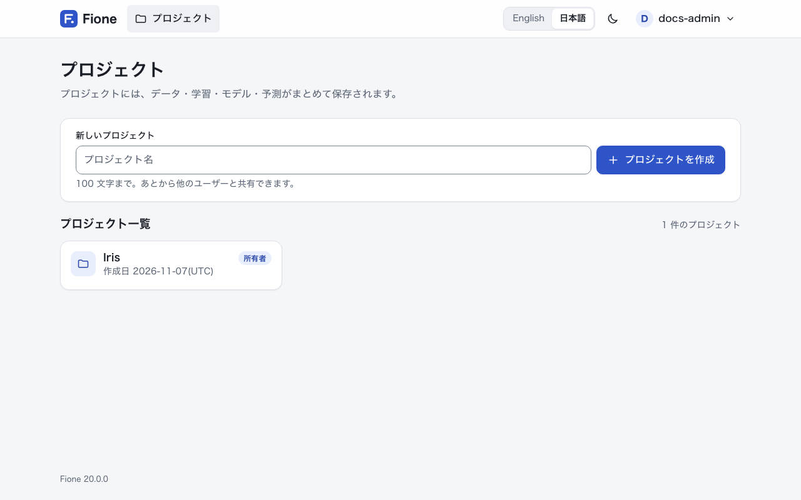
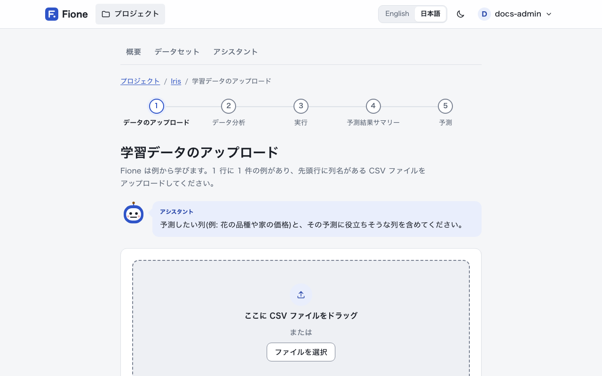
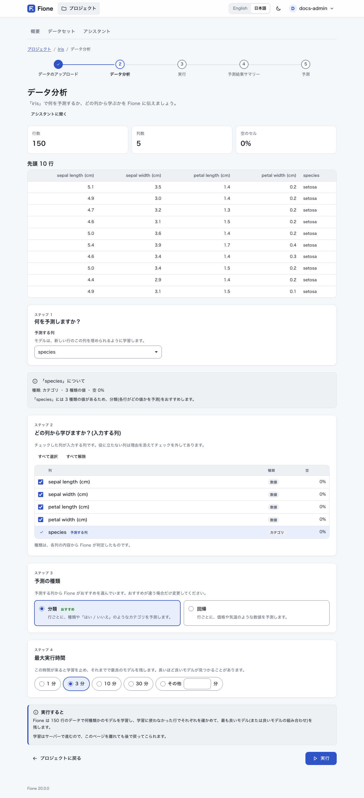
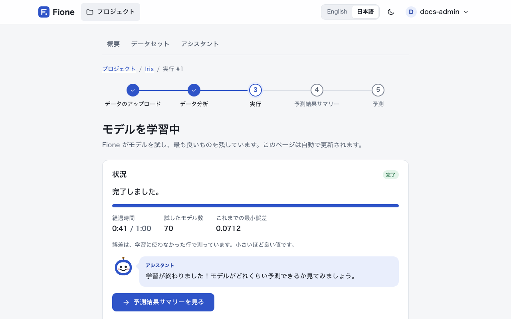
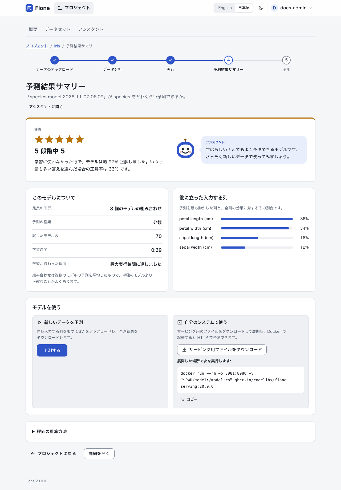
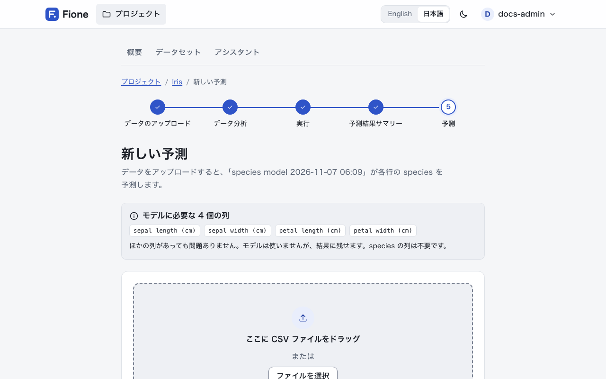
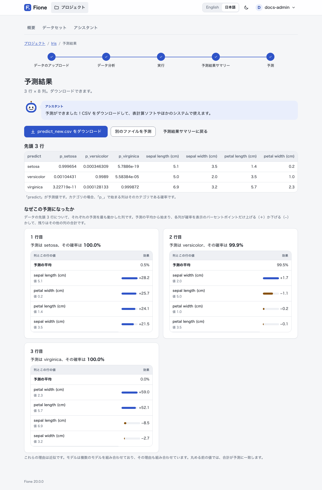

# EasyML ウィザード

EasyML ウィザードは、CSV ファイルから、学習済みのモデル、予測結果のファイル、動作する予測 API までを順に案内します。Fione の既定の表示で、機械学習の経験は要りません。

ウィザードは 5 つのステップで進みます。各ページの上部に進行状況が表示されます。**データのアップロード**、**データ分析**、**実行**、**予測結果サマリー**、**予測**の順です。このページでは、[インストール](/ja/guide/installation) で用意したアヤメのデータで手順を説明します。1 行目に列名がある CSV なら、同じ流れで使えます。

プロジェクトの作成、データのアップロード、学習、予測には、管理者または編集者のロールと、そのプロジェクトの編集権限が必要です。閲覧者は共有されたプロジェクトを見られますが、変更はできません([ユーザーと共有](/ja/guide/users-sharing) を参照)。

## 1. プロジェクトを作成する

プロジェクトには、データ・学習・モデル・予測がまとめて保存されます。



1. **プロジェクト**を開き、**新しいプロジェクト**にプロジェクト名(例: `Iris`)を入力して、**プロジェクトを作成**を押します。
2. 作成したプロジェクトを開きます。

## 2. データをアップロードする

1. プロジェクトで**学習データをアップロード**を押します。
2. `iris.csv` を選び(ページへのドラッグでも可)、**アップロードして分析**を押します。



ファイルには、列名の入った 1 行目と、1 行に 1 件の例が必要です。予測したい列(花の品種や家の価格など)と、その予測に役立ちそうな列を含めてください。

## 3. データ分析

**データ分析**のページには、行数・列数・空のセルの数と、データの先頭の行が表示されます。その下で、学習の内容を決めます。



- **何を予測しますか？**: Fione が予測する列をおすすめします(アヤメのデータでは `species`)。別の列にするには、列を選んで**更新**を押します。
- **予測の種類**: 分類(各行がどのカテゴリかを予測)か回帰(各行の数値を予測)のどちらかが**おすすめ**として示されます。おすすめが違う場合だけ変更してください。
- **どの列から学びますか？(入力する列)**: チェックした列が入力する列です。役に立たない列は、理由を添えてチェックが外されます。たとえば、答えのコピーになっている列、値で答えが決まってしまう列、行を識別するだけの列、値が 1 種類しかない列です。その列だけで答えを不自然なほどよく当てる列は、警告付きでチェックされたままになります。予測するときにその値が分かっているか確認してください。
- **最大実行時間**: **1 分**、**3 分**、**10 分**、**30 分**、または分単位で入力する**その他**から選びます。この時間が来ると学習を止め、それまでで最良のモデルを残します。長いほど良いモデルが見つかることがあります。Fione はデータの大きさに合った時間を初期値にし、長めの時間を選んだ場合はそのことを知らせます。

これらの上には、アシスタントがデータについて平易な言葉でコメントします。ボタン 1 つで始められる学習(**学習を始める**)を提案することもあります。これには言語モデルが必要です。言語モデルがないときは、コメントの代わりにアシスタントが使えない旨が表示されるので、そのまま手で進めてください。詳しくは [アシスタント](/ja/guide/assistant) をご覧ください。

アヤメのデータでは、おすすめのまま、**最大実行時間**で **1 分**を選び、**実行**を押します。

## 4. 実行

進行状況のページ(**モデルを学習中**)に、Fione の作業の様子が表示されます。試したモデル数、これまでの最小誤差、経過時間、残り時間です。ページは自動で更新されます。学習はサーバーで進むので、ページを離れても、あとで戻ってこられます。**学習を中止**を押すと、モデルを保存せずに学習を終えます。



学習が終わったら、**予測結果サマリーを見る**を押します。

## 5. 予測結果サマリー

**予測結果サマリー**には、次の内容が表示されます。



- 最良のモデルと、1〜5 個の星の**評価**。
- スコアの意味を平易な言葉で説明した文。学習に使わなかった行での結果で、単純な当て推量と比べています。
- アシスタントの短いコメント(言語モデルがあるとき)。
- **このモデルについて**: 最良のモデル(または複数のモデルの組み合わせ)、予測の種類、試したモデル数、学習時間、学習が終わった理由。
- **役に立った入力する列**: モデルが最も頼りにした列。

**評価の計算方法**で、評価の考え方を確認できます。Fione は、学習に使わなかった行でモデルを試し(交差検証)、単純な当て推量と比べます。当て推量は、分類ならいつも最も多いカテゴリ、回帰ならいつも平均値です。この比較を 0〜1 の値にして、0.2 未満が星 1 つ、0.2 増えるごとに星が 1 つ増えます。

学習中にエラーが起きた場合は、その時点で最良のモデルを残し、このページでそのことをお知らせします。そのようなモデルの評価は最大で星 2 つです。もう一度実行すると改善するかもしれません。

## 6. 予測する

1. サマリーで**予測する**を押します。**新しい予測**のページが開きます。
2. 学習データと同じ入力する列をもつ CSV を選び(予測する列は不要なので、`iris.csv` が使えます)、**アップロード**を押します。足りない列がある場合は、Fione が一覧で知らせるので、列を追加してもう一度アップロードしてください。ほかの列があっても問題ありません。モデルは使いません。
3. **結果に含める列**で、予測の横に残したいファイルの列を選びます。予測は必ず含まれます。**各予測の内訳を含める**を選ぶと、入力ごとに `contrib_` で始まる列が加わり、各行の予測をその入力がどれだけ動かしたかが分かります。時間がかかります。
4. **予測を実行**を押します。





**予測結果**のページに先頭の行が表示され、ファイルをダウンロードできます(`iris.csv` なら **predict_iris.csv をダウンロード**)。ファイルには、予測したクラスの `predict` 列と、クラスごとの確率の `p_<クラス>` 列があります。回帰のモデルでは、`predict` が予測した数値です。結果は、**予測結果**という種類のデータセットとして、プロジェクトにも保存されます。

**なぜこの予測になったか**では、先頭の 5 行について、予測の平均から出発して、どの列が予測を最も動かしたかが分かります。

## 7. モデルを公開する

モデルを自分のシステムから使うには、Fione Serving で予測 API として動かします。サマリーの**自分のシステムで使う**のカードに、**サービング用ファイルをダウンロード**(モデルのファイルが入った zip)と、実行する `docker run` コマンドが表示されます。

まず、サービング用イメージを 1 回ビルドします。モデルは学習したイメージのタグを記録していて、Fione Serving は同じタグのモデルしか読み込まないため、Fione と同じタグでビルドする必要があります。

```sh
docker compose -f docker/compose.yaml --env-file docker/.env --profile serving build fione-serving
```

次に、ダウンロードしたファイルがあるディレクトリで実行します。

```sh
unzip fione-serving-*.zip
docker run --rm -p 8081:8080 -v "$PWD/model:/model:ro" ghcr.io/codelibs/fione-serving:dev
```

別のターミナルで、モデルの入力する列を指定して 1 行を送ります。

```sh
curl -s -X POST localhost:8081/invocations -H 'Content-Type: application/json' -d '{"instances":[{"sepal length (cm)":5.1,"sepal width (cm)":3.5,"petal length (cm)":1.4,"petal width (cm)":0.2}]}'
```

応答は次のようになります。確率の値はモデルによって異なります。

```json
{"predictions":[{"label":"setosa","index":0,"class_probabilities":[0.9934803442259019,0.003455065889847104,0.0030645898842508773]}]}
```

止めるには Ctrl+C を押します。この予測 API に認証はなく、`-p 8081:8080` ではこのマシンのすべてのネットワークインターフェースに公開されます。このマシンだけで使うなら、`-p 127.0.0.1:8081:8080` にしてください。カードに表示されるコマンドは、モデルを学習したイメージのタグを使っています。`dev` 以外のタグで Fione をビルドした場合は、そのコマンドを使ってください。API の詳細は [Fione Serving](/ja/docs/serving) をご覧ください。

## ウィザードのその先へ

アカウントのメニュー(右上の自分の名前)の**表示**で**詳細**を選ぶと、AutoML 画面が使えます。この切り替えで変わるのは表示だけで、できる操作は変わりません。設定はブラウザごとに記憶されます。詳細表示では次のものが加わります。

- すべての列の統計とグラフ、すべての学習設定(データの大きさに合わせた推奨の実行時間から始まり、**データ分析**と同じ警告やヒントが表示されます): [AutoML 画面](/ja/guide/automl) を参照。
- ジョブ一覧と、リーダーボード・変数の重要度・スコアの履歴つきのモデル一覧、モデルのエクスポートとインポート: [AutoML 画面](/ja/guide/automl) を参照。
- 診断、説明、リーク警告: [説明とリーク警告](/ja/guide/explanations) を参照。
- プロジェクトの共有: [ユーザーと共有](/ja/guide/users-sharing) を参照。

管理者は、同じメニューからユーザー、Python モジュール、システムの状態も管理できます。Python から Fione を操作するには [Python クライアント (fione-sdk)](/ja/guide/sdk) を使います。データやモデルについて平易な言葉で質問するには [アシスタント](/ja/guide/assistant) を使います。本番で運用するときは [運用](/ja/docs/operations) をご覧ください。
