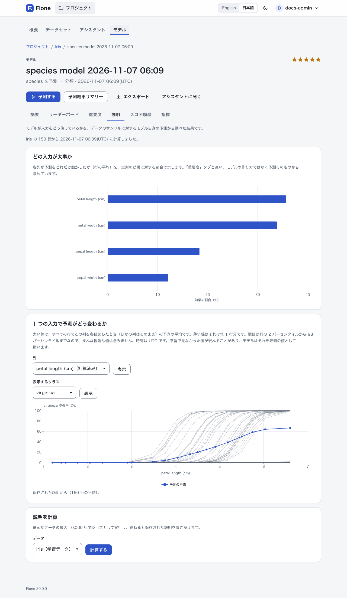

# モデルの説明とリークの警告

評価は、モデルがどれくらいよく予測できるかを教えてくれます。説明は、モデルがどのようにその予測に至ったか、そして信頼してよいかを教えてくれます。Fione には 3 種類の説明があり、いずれもプロジェクトのモデルのページ(**モデル**から該当のモデルを開く)にあります。学習の準備の段階では、リークの警告も出ます。

| 内容 | 場所 | 何から求めるか |
|---|---|---|
| [診断](#diagnostics): 混同行列、クラス別の値、ROC 曲線と適合率・再現率の曲線、較正、残差 | **指標**タブ | 学習時の交差検証の予測 |
| [重要度と部分依存](#importance) | **説明**タブ | データのサンプルに対するモデルの予測 |
| [各予測の寄与](#contributions) | 予測結果、バッチ予測、REST API、Fione Serving | 指定した行に対するモデル |
| [リークの警告](#leak-warnings) | データ分析、データセットのページ | 学習前の学習データ |

モデルのタブは詳細表示にあります([AutoML 画面](/ja/guide/automl#detailed-view)を参照)。予測結果の先頭の行の理由は、シンプル表示にも表示されます。

## 診断 {#diagnostics}

モデルの**指標**タブには、交差検証のスコアと、その下に、最終的な組み合わせの**交差検証の予測**から求めた図表が表示されます。交差検証の予測とは、各学習行について、その行を学習に使わなかったモデルが出した予測です。1 つのスコアではわからない、見たことのないデータでのモデルの振る舞いがわかります。

何行から求めたかは、タブに表示されます。20 万行を超えるときは、ランダムサンプルから求めます。

### 分類

- **混同行列**: 行が実際のクラス、列が予測したクラスです。各セルには行数と、実際のクラスに占める割合を示し、割合が大きいほど目立つ色になります。対角線は、モデルが正しく予測した分です。行と列があるのは件数の多い 30 クラスだけで、残りは**その他のクラス**にまとめて数えます。
- **クラス別の値**: **適合率**(そのクラスと予測した行のうち、実際にそのクラスだった割合)、**再現率**(そのクラスの行のうち、見つけられた割合)、**F1**(両方を組み合わせた値)と行数です。「—」は、一度も予測されなかったクラスの適合率のように、値が定まらないことを示します。クラスが非常に多いときは、件数の多いクラスだけを表示します。
- **ROC 曲線**、**適合率と再現率**、**確率の較正**は、2 クラスのときだけ、2 番目のクラス(並べ替えた順で最後のクラス。グラフにクラス名が表示されます)について表示します。ROC 曲線は、すべてのしきい値で、そのクラスの行を他の行より上位に並べられているかを示し、曲線の下の面積(AUC)も表示します。破線の対角線は当て推量です。適合率と再現率の曲線は、すべてのしきい値で、そのクラスという予測が正しい割合と、そのクラスの行を見つけられた割合を比べます。較正のグラフは、行を予測確率で 10 区間に分け、予測確率と実際にそのクラスだった割合を比べます。よく較正されたモデルは、破線の対角線の近くに並びます。

### 回帰

- **残差**: 実際の値から予測値を引いた値のヒストグラム(30 区間)です。残差が正なら、モデルは低く予測しています。
- **実際の値と予測値**: 無作為に選んだ最大 2,000 行の散布図で、並び順も無作為です。破線の対角線上の点は、ぴったり予測できた行です。
- 予測値の順に行を 10 等分した各区間の残差の平均は、特定の範囲でモデルに偏りがあるかを示します。

### 知っておくこと

- 早期終了とアンサンブルの重みが同じ予測で決まるため、診断は交差検証のスコアと同じく、やや楽観的です。
- 診断なしでインポートしたモデルや、診断を計算できなかった、または 256 KiB を超えたモデルには、診断がありません。
- 診断には学習データの値が含まれます。クラスのラベルと、回帰では学習行から抜き出した最大 2,000 件の実際の目的変数の値とその予測値です。プロジェクトを読めるすべての人に見え(タブと `GET /api/v1/models/{id}/diagnostics`)、モデルのエクスポートにも入り、学習データのデータセットを削除しても残ります。モデルファイルとサービング用ファイルには診断は入りません。

## 重要度と部分依存 {#importance}

**説明**タブには、データのサンプルに対するモデル自身の予測から調べた、モデルが入力をどう使っているかが表示されます。



**説明のジョブ**が、学習のたびに計算します(ジョブ一覧では**説明**と表示されます。サーバーの設定で待機に入れないこともできます。[設定](/ja/docs/configuration)を参照)。学習データの最大 10,000 行を読み、2 つを保存します。

- **どの入力が大事か**: 各列が予測をどれだけ動かしたか(行の平均)を、全列の効果に対する割合で示します。[後述](#contributions)の寄与の絶対値の平均で、最大 1,000 行を、各クラスの割合が保たれるように選んで求めます。**重要度**タブとは異なります。**重要度**タブはモデルの作り方(gain、不純度、重み)から求めますが、**説明**タブは予測そのものから求めます。派生特徴量は、読んでいる列の分として数え、複数の列を読むときは等分します。
- 重要度の高い 10 列の**部分依存**の曲線(次の節を参照)。

説明を、いつ、どのデータセットの何行から計算したかも、タブに表示されます。

**説明を計算**(編集権限が必要)は、選んだデータセットの最大 10,000 行で説明のジョブをもう一度実行し、終わると保存された説明を置き換えます。学習データがもうないモデルや、インポートしたモデルは、自分のデータセットを持たないため、モデルが使うすべての列があるデータセットを選んでください。それまでは、保存済みの曲線だけが表示されます。

### 部分依存 {#partial-dependence}

**1 つの入力で予測がどう変わるか**で列を選び、**表示**を押します。太い線は、すべての行でこの列を各値にしたとき(ほかの列はそのまま)の予測の平均です。薄い線はそれぞれ 1 行分です(1 行ごとの線は 1 つのクラスの分だけ、最大 50 行を保存します)。線が急なら、その列が予測を強く動かします。平らなら、ほとんど影響しません。曲がっていれば、非線形の効果があります。

- 数値は、列の 2 パーセンタイルから 98 パーセンタイルまでの最大 20 点なので、まれな極端な値は含みません。カテゴリは、多い値(最大 19 個)と欠損値の点です。時刻は UTC です。学習で見なかった値が現れることがあり、モデルはそれを未知の値として扱います。
- 曲線が保存済みの列には **(計算済み)** と表示されます。それ以外のモデルの列は、最大 300 行からその場で計算するので、保存済みの曲線と点が少し異なることがあります。
- 分類では**表示するクラス**でクラスを選びます。回帰の曲線は、予測値です。

## 各予測の寄与 {#contributions}

寄与は、1 つの入力列が、1 件の予測をモデルの平均的な予測からどれだけ動かしたかを表します。1 行について、次のようになります。

```text
バイアス + 列 1 の寄与 + 列 2 の寄与 + ... = 予測
```

合計は丸め誤差の範囲で一致します。単位は予測と同じで、分類では確率(log-odds ではありません)、回帰では目的変数の単位です。Fione が 1 行につき説明するのは 1 つの出力です。2 クラスでは 2 番目のクラスの確率(最後の `p_` 列)、それ以上のクラスでは予測したクラス(REST API では別のクラスを `class_index` で指定できます)、回帰では値です。

寄与は近似です。アンサンブルの各メンバーは、LightGBM・XGBoost・CatBoost は TreeSHAP、RandomForest と ExtraTrees は経路ごとの寄与、Linear と TextLinear は係数と学習データの平均からの差の積(正確な値)、DeepLearning は積分勾配で求めます。それらを確率に変換し、アンサンブルで合成します。厳密な Shapley 値になるのは、変換の前のブースター単体だけです。派生特徴量は、読んでいる列の分として数え、複数の列を読むときは等分します。

### 予測結果で

予測の結果を開くと、**なぜこの予測になったか**のカードが先頭の 5 行を説明します。行ごとに、予測を最も動かした列(上位 5 列)を、その行での列の値と効果(パーセントポイント、または目的変数の単位)とともに示し、残りは**その他の列**にまとめます。**予測の平均**から始まります。説明に時間がかかるモデルでは、**理由を表示**を押したときに計算します。列とクラスが非常に多いモデルは、ここでは説明できません。

### バッチ予測で

予測のフォームで**各予測の内訳を含める**を選びます(API では `include_contributions`)。結果に、モデルの入力ごとの `contrib_<列>` 列が付き、最後に平均的な予測である `contrib_bias` が付きます(入力に `bias` という列があると `contrib_bias_2`)。ファイルにこれらの列名と同じ名前の列があるときは、その列は `input_<名前>` になります。結果のページには寄与の列を先頭の 20 列まで表示し、ダウンロードにはすべて入ります。

通常の予測よりかなり遅く、最大 100,000 行までです。1 行あたり入力の列数 + 1 個の数値の列が増えるので、列の非常に多いモデルでは非常に大きなファイルになります。予測のフォームについては [AutoML 画面](/ja/guide/automl#batch-predictions)を参照してください。

### REST API で

API トークンを使います([REST API](/ja/docs/rest-api)を参照)。

```sh
curl -s -X POST http://127.0.0.1:8080/api/v1/models/<model-id>/contributions \
  -H "Authorization: Bearer <your-token>" -H "Content-Type: application/json" \
  -d '{"instances":[{"sepal length (cm)":5.1,"sepal width (cm)":3.5,"petal length (cm)":1.4,"petal width (cm)":0.2}]}'
```

最大 100 件の `instances`(Fione Serving と同じ、列名をキーにしたオブジェクト)か、`dataset_id` と `offset`、`limit` のどちらかを指定します。答えの各行には、`prediction`、`bias`、列ごとの `contributions` があり、3 クラス以上では `class_index` も付きます。関連するエンドポイントは次のとおりです。

- `POST /api/v1/models/{id}/partial-dependence`: 1 列の曲線(`column`、任意で `dataset_id`、`grid`、`rows`、`ice`、`class_index`)
- `GET /api/v1/models/{id}/explanations`: 保存された重要度と曲線、説明のジョブの状態
- `GET /api/v1/models/{id}/diagnostics`: 診断
- `POST /api/v1/projects/{id}/jobs/explain`: 説明のジョブを待機に入れる(編集権限が必要)

寄与のエンドポイントと、ここに挙げた最初の 3 つは、プロジェクトの読み取り権限があれば使えます。説明のジョブを待機に入れるには編集権限が必要です。寄与と部分依存はリクエストごとに計算し、サーバー全体で 1 件ずつ処理します。長く待たされるリクエストは、`Retry-After` ヘッダー付きの `503`(混雑)になります。ファイルが 512 MiB を超えるモデルや、この環境で署名していないインポートはここでは断り(`409`)、説明のジョブだけが説明できます。

### Fione Serving で

`/invocations` へのリクエストに `"contributions": true` を加えると、予測した行ごとに、`bias` と各入力列の値を持つ `contributions` が付きます。1 リクエストは最大 100 件で、同時に処理するのは 2 リクエストまでです。リクエストとレスポンス、制限については [Fione Serving](/ja/docs/serving) を参照してください。

## リークの警告 {#leak-warnings}

*リーク*とは、答えを教えてしまう列のことです。たとえば、結果が分かってから記録される値などです。そのような列から学んだモデルは、学習時には非常に良く見えますが、値が分からない新しいデータでは失敗します。Fione は学習の前に疑わしい列を探して知らせます。

結果は、ウィザードのデータ分析([EasyML ウィザード](/ja/guide/easyml)を参照)、学習の設定のページ、データセットの**列**タブの**注記**、列のページに表示されます。既定で予測する列、またはあなたが選んだ列を基準に判断します。

警告には 2 段階あります。

- **完全なリークはチェックを外します。** 予測する列と同じ列や、値ごとに答えが必ず決まる列は、理由を添えて、既定で入力する列から外します(行を識別するだけの列も ID として外れます)。
- **疑わしい列は、警告付きでチェックされたままです。** その列だけで答えを不自然なほどよく当てる列、値の並び(または値が空かどうか)が答えと連動する列(答えの順に行を追加したときの ID や日時など)、答えとほぼ完全に連動する列(相関の絶対値が 0.99 以上)です。予測するときにその値が本当に分かっているかを確認し、分からないならチェックを外してください。

スコアの仕組み: 各列を単独でいくつかの区間に分けて、予測する列を、学習に使わなかった分割(out-of-fold)で予測し、その結果を AUC(分類。3 クラス以上では 1 対その他の AUC の平均)または R²(回帰)で採点します。AUC が 0.95(回帰では R² が 0.90)以上で、その線未満で最も高い列より 0.10 以上高い列、またはどの場合でも 0.99 以上の列が警告されます。

警告はどちらの向きにも間違えます。強い正当な列が警告されることも、リークを見逃すこともあるため、警告がないことはリークがないことを意味しません。見逃す場合は[既知の制限](/ja/docs/known-limitations#explanations-and-leak-warnings)を参照してください。確認に使うのは最大 10,000 行で、200 行未満のデータは採点せず、3 秒で打ち切って、確認していない列があることを表示します。

## 次のステップ

- [AutoML 画面](/ja/guide/automl): モデルのタブ、リーダーボード、学習の設定
- [Fione Serving](/ja/docs/serving): 予測 API での寄与
- [既知の制限](/ja/docs/known-limitations): 説明が行わないこと
