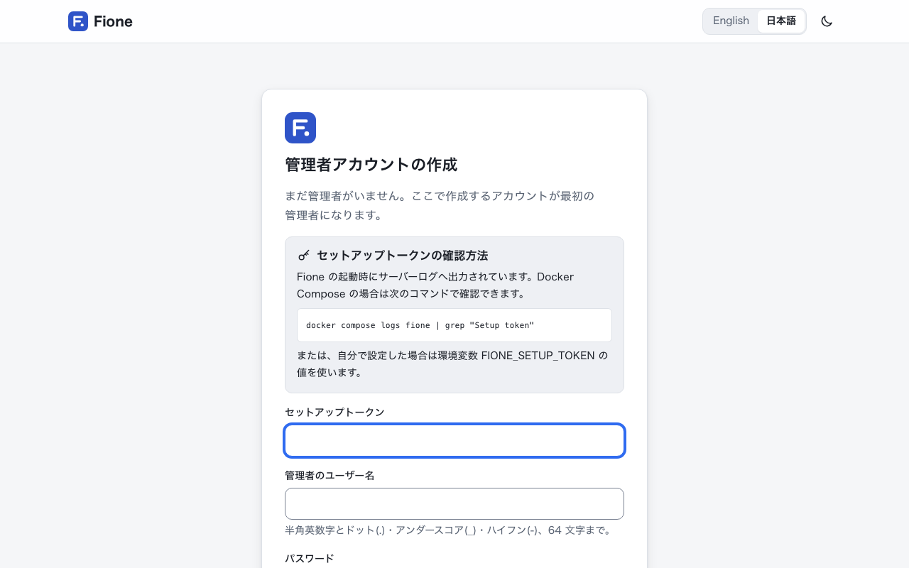

# インストールとクイックスタート

このページでは、Docker を使って、何もない状態から管理者アカウントのある Fione が動くところまで進めます。初回のビルドには数分かかります。

## 必要なもの

- Docker と Compose v2(Docker Desktop、または compose プラグイン付きの Docker Engine)。
- イメージとビルドキャッシュ用に約 6 GB のディスク空き容量と、データ用の空き容量。
- `git`、`openssl`、`unzip`、`curl`。
- 最近のブラウザ: Chrome または Edge 123 以降、Firefox 120 以降、Safari 17.5 以降(それより古いブラウザではライトテーマだけ使えます)。

イメージは、Fione のリポジトリからお使いのマシン上でビルドします。amd64 と arm64(Apple シリコン)で動きます。

## 1. Fione を取得してシークレットを設定する

```sh
git clone https://github.com/codelibs/fione.git
cd fione
printf 'FIONE_S3_ACCESS_KEY=%s\nFIONE_S3_SECRET_KEY=%s\n' "$(openssl rand -hex 16)" "$(openssl rand -hex 32)" > docker/.env
```

`docker/.env` には、Fione とストレージ(SeaweedFS)が共有する認証情報が入ります。Git の管理対象外なので、外に漏れないように保管してください。どちらかの値が空のままだと、Compose は起動を拒否します。ほかの任意の値は `docker/.env.example` に、すべての設定は [設定](/ja/docs/configuration) にまとめています。

## 2. 起動する

```sh
docker compose -f docker/compose.yaml --env-file docker/.env up -d --build --wait
```



初回は機械学習ライブラリをダウンロードしてインストールするため、ビルドに数分かかります。`--wait` は、2 つのコンテナ(`fione` と `seaweedfs`)が正常になると戻ります。Fione は <http://127.0.0.1:8080/> で開きます。このポートは、このマシンだけに公開されています。ほかの人にも使ってもらうには、HTTPS のリバースプロキシを前に置いてください([設定](/ja/docs/configuration)のリバースプロキシの項を参照)。

## 3. 管理者を作成する

Fione に既定のパスワードはありません。管理者ができるまでは、起動のたびにセットアップトークンをログへ出力します。

```sh
docker compose -f docker/compose.yaml --env-file docker/.env logs fione | grep "Setup token"
```

<http://127.0.0.1:8080/> を開くと、**管理者アカウントの作成**のページが表示されます。次の項目を入力します。

- ログに出ている**セットアップトークン**
- **管理者のユーザー名**(半角英数字とドット・アンダースコア・ハイフン、64 文字まで)
- **パスワード**(8 文字以上)と**パスワード(確認)**

**管理者を作成**を押すと、そのままログインした状態になります。

この操作は起動後なるべく早く行ってください。管理者ができるまでは、ログを読める人なら誰でも管理者を作れてしまいます。トークンを自分で決めたい場合は、起動前に `docker/.env` に `FIONE_SETUP_TOKEN`(16 文字以上)を設定します。管理者ができると、トークンは使えなくなります。

以降は、ログインのページでユーザー名とパスワードを入力してログインします。ほかのユーザーは管理者が追加します。詳しくは [ユーザーと共有](/ja/guide/users-sharing) をご覧ください。

## 4. 試用する CSV を用意する

1 行目に列名がある CSV なら何でも使えます。定番のアヤメのデータで試すには、scikit-learn に付属するデータを、動作中のコンテナから書き出します。

```sh
docker compose -f docker/compose.yaml --env-file docker/.env exec -T fione python -c "from sklearn.datasets import load_iris; d = load_iris(as_frame=True); f = d.frame; f['species'] = d.target_names[f.pop('target')]; f.to_csv('/dev/stdout', index=False)" > iris.csv
```

これで `iris.csv` ができます。150 行で、4 つの測定値と `species` の列があります。Fione は、UTF-8、Shift_JIS、EUC-JP の CSV を読み込めます。列の区切りはカンマ・セミコロン・タブ・`|` が使え、列名は 1 行目に入れます。アップロードできるサイズの既定の上限は 1 GiB です。

## アシスタントのバナーについて

アシスタントには言語モデルが必要ですが、このクイックスタートでは用意しません。言語モデルに接続できない間は、各ページにアシスタントがまだ答えられないことを知らせるバナーが出ます(例: 「アシスタントは今、言語モデルのサーバーに接続できません。」)。これは想定どおりの表示です。学習・予測・公開はアシスタントなしで動き、使えないのはアシスタントのコメントと提案だけです。言語モデルを用意する方法は [アシスタント](/ja/guide/assistant) をご覧ください。

## 次のステップ

[EasyML ウィザード](/ja/guide/easyml) に進み、`iris.csv` で最初のモデルを学習しましょう。あとで Fione を止めたり、バックアップやアップグレードをしたりするときは、[運用](/ja/docs/operations) をご覧ください。
