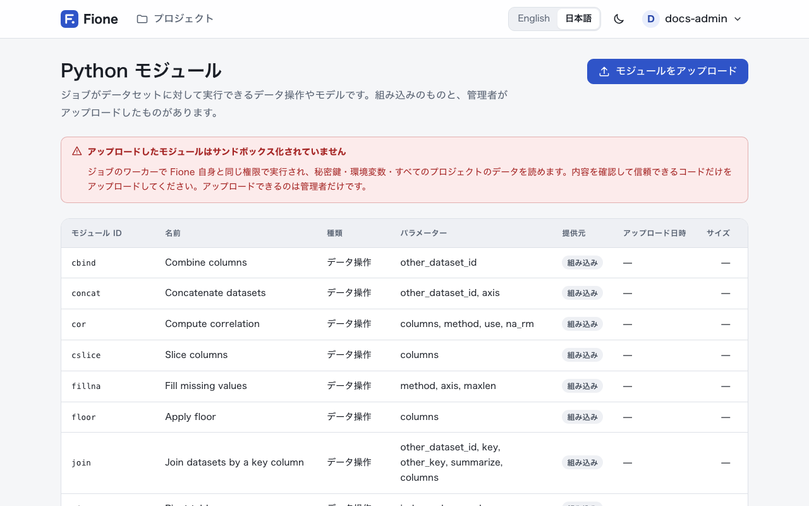

# データ操作のための Python モジュール

**Python モジュール**は、サーバー上のジョブとして実行されるデータ操作です。データセットといくつかのパラメーターを受け取り、新しいデータセットを作ります。Fione には、表の基本的な操作、k-means クラスタリング、低ランク分解の組み込みモジュールがあり、管理者は独自のモジュールをアップロードできます。

モジュールは入力を変更しません。結果は同じプロジェクトの新しいデータセットとして保存されるので、中身を確認したり、学習に使ったり、別のモジュールに渡したりできます。

## モジュールの場所

アカウントメニューから **Python モジュール**を選びます。管理者には常にこの項目が表示され、ほかのユーザーには、同じメニューの**表示**を**詳細**にしたときに表示されます。ページには、すべてのモジュールのモジュール ID、名前、種類、パラメーター、提供元（**組み込み**または**アップロード**）、アップロードしたものはアップロード日時が一覧で表示されます。



ログインできるユーザーなら誰でも一覧を見られます。モジュールの実行にはプロジェクトの書き込み権限が、アップロードと削除には管理者ロールが必要です。

モジュールは [Python クライアント](/ja/guide/sdk)または [REST API](/ja/docs/rest-api) からジョブとして実行します。このページは一覧（カタログ）です。アシスタントが結合を提案し、あなたが確認して実行することもできます（[アシスタント](/ja/guide/assistant)を参照）。

## モジュールの種類

| 種類 | ページでの表示 | 内容 |
|---|---|---|
| `frame` | データ操作 | データセットを別のデータセットに変換します。 |
| `train` | モデルの学習 | データセットを新しいデータセットに変換し、**同時に**小さな学習済みの状態（Fione ではモジュールモデルと呼びます）を保存します。 |
| `predict` | 予測 | モジュールモデルの状態をデータセットに適用します。状態の ID は `module_model_id` で渡します。 |

`predict` モジュールの結果は `predict` タイプのデータセット、ほかのモジュールの結果は `train` タイプのデータセットとして保存されます。`name` を指定しない場合、新しいデータセットの名前は `<モジュール ID>_<入力データセット名>` になります。

## 組み込みモジュール

### データ操作

| ID | 名前 | 内容 |
|---|---|---|
| `cbind` | Combine columns | 2 つ目のデータセット（`other_dataset_id`）の列を、1 つ目の列の右に並べます。行数が同じである必要があります。 |
| `rbind` | Combine rows | 2 つ目のデータセット（`other_dataset_id`）の行を、1 つ目の下に積みます。列が同じである必要があります。 |
| `concat` | Concatenate datasets | 2 つのデータセットを横に並べる（`axis` が 1、初期値）か、縦に積みます（`axis` が 0）。 |
| `join` | Join datasets by a key column | キー（`key`）が同じ行に、もう一方のデータセットの列を追加します。1 つ目の行はすべて残ります。詳しくは後述します。 |
| `cslice` | Slice columns | 指定した `columns` だけを残します。 |
| `rslice` | Slice rows | `row_conditions` に合う行だけを残します。 |
| `replace` | Replace values | `row_conditions` に合う行（空ならすべての行）の `column` を `value` に置き換えます。 |
| `sort` | Sort | `column` で並べ替えます。初期値は昇順です。 |
| `fillna` | Fill missing values | 欠損値を前方または後方（`method`）の値で、`axis` の方向に、連続して最大 `maxlen` セルまで埋めます。 |
| `floor` | Apply floor | 数値の `columns` を切り捨てた結果を返します。 |
| `cor` | Compute correlation | 数値の `columns` の相関行列を返します（`method` は `pearson` か `spearman`）。 |
| `pivot` | Pivot table | `index` の値ごとに 1 行、`column` の値ごとに 1 列を作り、`value` で埋めます。 |
| `split` | Split into train, valid and test | `train_ratio`、`valid_ratio`、`test_ratio`（初期値は 70、15、15）と `seed` によるランダム分割のうち、`part`（`train`、`valid`、`test`）の 1 つを返します。 |
| `tokenize` | Tokenize text | テキスト列（`target_column`）を 1 行 1 トークンに分割します。各文書の後ろに空行が入ります。 |

`row_conditions` は `age >= 30 & country == JP` のような文字列です。`列 演算子 値` の形の条件を、`&`（かつ）と `|`（または）でつなぎます（演算子は `==`、`!=`、`<`、`<=`、`>`、`>=` で、前後に空白が必要です）。`&` のほうが先に評価されます。空の文字列は、すべての行に一致します。

**結合について。** `join` は、1 つ目のデータセットの `key` と、もう一方の `other_key`（空なら同じ名前の列）を照合します。もう一方のデータセットでは、同じキーが 1 行にだけ現れる必要があります。複数行に現れる場合は `summarize` を `true` にします。もう一方のデータセットがキーごとの 1 行にまとめられ、行数（`rows`）、数値列の平均・最小・最大・合計、その他の列の値の種類数が追加されます。`columns` を指定すると、もう一方のデータセットのその列だけが追加（または集計）されます。

### クラスタリングと低ランク分解

どちらも組になっています。`train` モジュールがデータセットから学習し、`predict` モジュールが同じ列を持つ任意のデータセットに学習結果を適用します。

| ID | 名前 | 主なパラメーター |
|---|---|---|
| `kmeans_train` | K-means (train) | `columns`（空ならすべての列。どれも数値列であること）、`k`（初期値 3）、`init`、`max_iterations`、`standardize`（初期値 `true`）、`seed`、`output_columns` |
| `kmeans_predict` | K-means (assign clusters) | `module_model_id`（`kmeans_train` の状態）、`output_columns` |
| `lowrank_train` | Low-rank projection (train) | `columns`、`method`（`svd` か `nmf`）、`n_components`（初期値 2）、`seed`、`output_columns` |
| `lowrank_predict` | Low-rank projection (project) | `module_model_id`（`lowrank_train` の状態）、`output_columns` |

k-means は `cluster` 列を、低ランク分解は `component_1`、`component_2` などの列を追加します。結果にはこれらの列と、`output_columns` で指定した入力列だけが含まれます。欠損値は学習時の列の平均値で置き換えられます。選んだ列はすべて整数または浮動小数点の列（テキスト、日付、真偽値は不可）である必要があり、そうでないとジョブは失敗し、該当する列の名前が示されます。テキスト列は、数値列だけを `columns` に列挙して除いてください。`floor` と `cor` も同様です。

各モジュールのパラメーターの全一覧（型、初期値、上限・下限）は、`GET /api/v1/modules` で取得できます。

## モジュールを実行する

モジュールの実行はジョブです。[Python クライアント](/ja/guide/sdk)では次のようにします。

```python
from fione_sdk import Client

fione = Client()
job = fione.run_module(
    "<project-id>", "sort", dataset_id, {"column": "age"}, name="sorted by age"
)
job.wait()
sorted_frame = fione.read("<project-id>", job.result["dataset_id"])
```

[REST API](/ja/docs/rest-api) では、`POST /api/v1/projects/<project-id>/jobs/module` にモジュール、データセット、パラメーターを渡します。

```sh
curl -X POST http://localhost:8080/api/v1/projects/<project-id>/jobs/module \
  -H "Authorization: Bearer <your-token>" \
  -H "Content-Type: application/json" \
  -d '{"module_id": "sort", "dataset_id": 1, "params": {"column": "age"}}'
```

ジョブが完了すると、`result.dataset_id` が新しいデータセットです。`train` モジュールは `result.module_model_id` も返します。これを対応する `predict` モジュールの `module_model_id` に渡します。

```python
train = fione.run_module(
    project_id, "kmeans_train", train_id, {"k": 3, "columns": ["sepal_length", "sepal_width"]}
).wait()
clusters = fione.run_module(
    project_id, "kmeans_predict", new_rows_id, {"module_model_id": train.result["module_model_id"]}
).wait()
```

パラメーターはジョブをキューに入れる前に検証されます。未知のパラメーター名、必須パラメーターの不足、型の違いはその場で拒否されます。ジョブは短時間ジョブのキューで実行され（同時実行数は `FIONE_MAX_CONCURRENT_SHORT_JOBS`）、データセット全体をメモリに読み込みます。

## 独自のモジュールをアップロードする（管理者）

モジュールは、UTF-8 で 256 KB までの Python ファイル 1 つです。モジュールを説明する辞書 `MODULE` と、処理を行う関数 `run(df, params, ctx)` の 2 つを定義します。

```python
# sepal_area.py
MODULE = {
    "name": "Add sepal area",
    "kind": "frame",
    "params": {
        "properties": {
            "scale": {"type": "number", "default": 1.0},
        },
        "required": [],
    },
}


def run(df, params, ctx):
    return df.assign(sepal_area=df["sepal_length"] * df["sepal_width"] * params["scale"])
```

### `MODULE`

`MODULE` には 3 つのキーがすべて必要です。

| キー | 意味 |
|---|---|
| `name` | ページに表示する名前です（100 文字を超えると短縮されます）。 |
| `kind` | `"frame"`、`"train"`、`"predict"` のどれか。 |
| `params` | パラメーターを `{"properties": {...}, "required": [...]}` の形で記述します。各プロパティには `type` が必要で、`default`、`description`、`enum`、`minimum`、`maximum`、`maxLength`、`maxItems`、`items` も指定できます。 |

パラメーターの `type` は `string`、`integer`、`number`、`boolean`、`array`（文字列の配列）のいずれかで、これ以外は使えません。入れ子の辞書は受け取れません。Fione はジョブごとに、この記述に沿ってパラメーターを検証し、`run` を呼ぶ前に初期値を補います。

次の 2 つのパラメーター名には特別な意味があり、型は整数にする必要があります。

- `other_dataset_id`: `ctx.other` に、そのデータセットが 2 つ目のデータフレームとして入ります。
- `module_model_id`: `ctx.state` に、`train` モジュールが保存した状態が入ります。`predict` モジュールでは必ず宣言します。

### `run(df, params, ctx)`

- `df` は入力データセットで、pandas の DataFrame です。
- `params` は検証済みのパラメーターで、初期値が補われています。
- `ctx` には `other`（2 つ目のデータセット。なければ `None`）と `state`（保存された状態。なければ `None`）があります。
- `frame` と `predict` のモジュールは DataFrame を返します。`train` モジュールは `(DataFrame, state)` の組を返します。`state` は JSON オブジェクト（文字列、数値、真偽値、リスト、辞書でできた辞書）で、8 MB までです。pickle は使いません。状態は単なる JSON なので、読み込んでもコードは実行されません。

返す DataFrame には 1 列以上が必要で、列名は重複しない文字列にし、セル数（行数 × 列数）は 1 億 5,000 万以下にします。`run` が例外を送出するとジョブは失敗し、メッセージには例外の種類が含まれます。メッセージからはファイルパスが取り除かれます。

`train` と `predict` の組は次のようになります。

```python
# column_mean_train.py
MODULE = {
    "name": "Column mean (train)",
    "kind": "train",
    "params": {
        "properties": {"column": {"type": "string"}},
        "required": ["column"],
    },
}


def run(df, params, ctx):
    column = params["column"]
    return df, {"column": column, "mean": float(df[column].mean())}
```

```python
# column_mean_apply.py
MODULE = {
    "name": "Center on the column mean",
    "kind": "predict",
    "params": {
        "properties": {"module_model_id": {"type": "integer"}},
        "required": ["module_model_id"],
    },
}


def run(df, params, ctx):
    column, mean = ctx.state["column"], ctx.state["mean"]
    return df.assign(**{column + "_centered": df[column] - mean})
```

### アップロードする

Web アプリでは、**Python モジュール**を開き、**モジュールをアップロード**を選び、**モジュール ID** を入力し、**Python ファイル(.py)** を選びます。コードがサンドボックスなしで実行されることを理解したことを確認するチェックを入れて、**モジュールをアップロード**を選びます。ID は 1〜40 文字の英小文字・数字・`_` で、英字から始めます。組み込みモジュールや、すでにあるモジュールの ID は使えません。

API では、`id` と `file` のフィールドを持つ multipart フォームでファイルをアップロードします。

```sh
curl -X POST http://localhost:8080/api/v1/modules \
  -H "Authorization: Bearer <your-token>" \
  -F id=sepal_area \
  -F file=@sepal_area.py
```

Fione は、ファイルを短時間だけ動く別プロセスで 1 度インポートして `MODULE` を読み取り、記述を検証します（10 秒以内に読み込める必要があるため、ファイルの先頭レベルの処理は軽くしてください）。構文エラー、`MODULE` や `run` の欠落、未知の `kind`、整数の `module_model_id` を持たない `predict` モジュールは、メッセージ付きで拒否されます。

モジュールを置き換えるには、先に削除してからアップロードし直します。モジュールの削除（ページの**削除**、または `DELETE /api/v1/modules/<module-id>`）では、そのモジュールが学習した状態も削除されます。データセットと完了したジョブの結果は残ります。組み込みモジュールは削除できません。

::: warning アップロードしたモジュールはサンドボックス化されていません
アップロードしたモジュールは、ジョブのワーカーで Fione 自身と同じ権限で実行されます。インストールの秘密鍵、環境変数、すべてのプロジェクトのデータを読めます。内容を確認して信頼できるコードだけをアップロードしてください。そのため、アップロードできるのは、警告を確認した管理者だけです。組み込みモジュールには影響しません。
:::

モジュールを置き換えたとき、まだ待機中のジョブは、キューに入れた時点のソースではなく、新しいソースで実行されます。この点とモジュールに関するその他の注意は、[既知の制限](/ja/docs/known-limitations)を参照してください。
