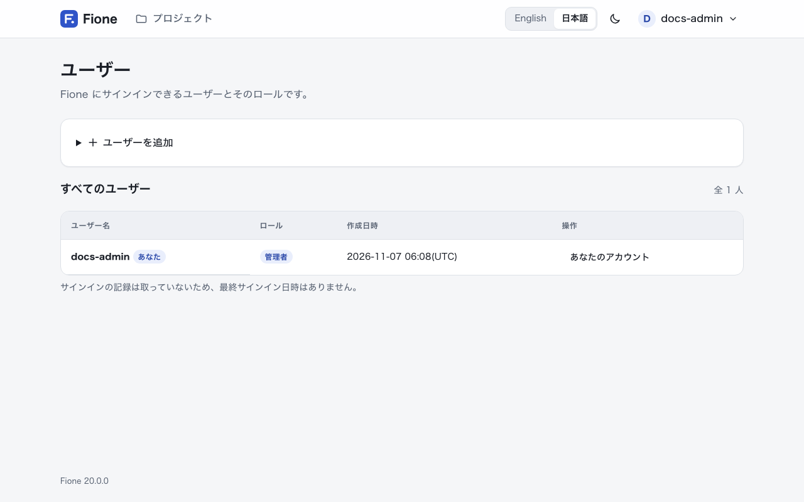
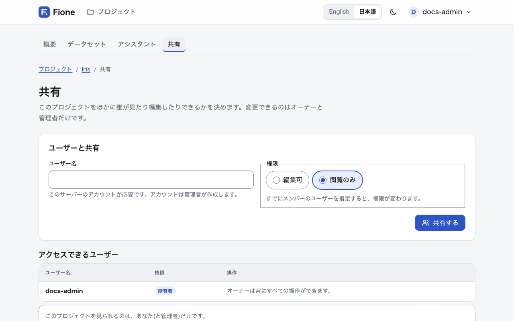
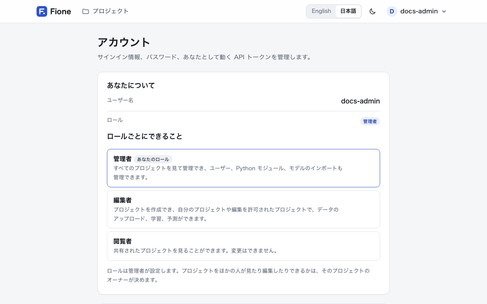

# ユーザー・ロール・共有

Fione は複数人で使うサーバーです。アカウントは管理者が作成し、すべてのアカウントに**ロール**があり、プロジェクトは**ユーザー単位**で共有します。このページでは、誰が何をできるのか、ユーザー・共有・API トークンをどう管理するのかを説明します。

## ロール

ユーザーは次の 3 つのロールのどれかを持ち、ロールは管理者が設定します。

| ロール | できること |
|---|---|
| **管理者** | すべてのプロジェクトを見て管理でき、どのプロジェクトでも所有者として操作できます。ユーザー、Python モジュール、モデルのインポートを管理し、「システムの状態」画面も見られます。 |
| **編集者** | プロジェクトを作成できます。自分が所有するプロジェクトや、**編集可**で共有されたプロジェクトで、データのアップロード、学習、予測ができます。 |
| **閲覧者** | 共有されたプロジェクトを見ることができます。変更はできず、プロジェクトも作成できません。 |

同じ説明は、各自の**アカウント**画面の「ロールごとにできること」にも表示されます。

## プロジェクトの権限

ロールは「その人が一般にできること」を決めます。そのうえで、プロジェクトごとに「誰が使えるか」を決めます。

| 権限 | 対象 | できること |
|---|---|---|
| **所有者** | プロジェクトを作成した人と、すべての管理者 | プロジェクトの共有や削除を含む、すべての操作。 |
| **編集可** | 所有者が共有したユーザー | データのアップロード、学習、予測、プロジェクト内のデータセット・モデル・ジョブの削除。 |
| **閲覧のみ** | 所有者が共有したユーザー | プロジェクトを見ること。 |

ロールと権限は次のルールで組み合わさります。

- **誰とも共有していないプロジェクトは非公開です。** 見られるのは所有者と管理者だけです。
- **閲覧者は、プロジェクトでどの権限を与えられても見るだけです。** 閲覧者に**編集可**で共有しても、変更はできません。プロジェクトを持っている編集者を閲覧者に変更すると、そのプロジェクトも本人にとっては読み取り専用になります。
- **「見る」にはダウンロードも含まれます。** 「閲覧のみ」以上の権限があれば、データセット、グラフ、説明を開き、データセットを CSV で、モデルのエクスポートや Serving 用バンドルをダウンロードできます。モデルファイルのインポートは管理者だけです。

## 初めてのログイン

インストール直後はユーザーがいません。最初の管理者は、Fione の起動時にログへ出力されるセットアップトークン（`FIONE_SETUP_TOKEN` を設定した場合はその値）を使って、初期設定の画面で作成します。手順は[インストールとクイックスタート](/ja/guide/installation)を参照してください。管理者ができた後はこのトークンは使えなくなり、ほかのアカウントはすべて管理者が作成します。

ログインはユーザー名とパスワードで行います。

- ユーザー名は 1〜64 文字で、半角英数字、ドット(`.`)、アンダースコア(`_`)、ハイフン(`-`)が使えます。
- パスワードは 8 文字以上です。
- パスワードをユーザー自身が再設定する機能はありません。ログイン画面には「パスワードを忘れた場合は、管理者に再設定を依頼してください。」と表示されます。
- ログインの有効期間は初期設定で 7 日間です（`FIONE_SESSION_MAX_AGE_SECS`）。同じアドレスから同じユーザー名で 15 分以内に 5 回失敗すると、しばらくログインできなくなります（`FIONE_LOGIN_MAX_FAILURES`、`FIONE_LOGIN_WINDOW_SECS`）。どちらの設定も[設定リファレンス](/ja/docs/configuration)にあります。

自分のパスワードを変えるには、アカウントメニューから**アカウント**画面を開き、「パスワードの変更」を使います。現在のパスワードの入力が必要です。変更後もそのブラウザではログインしたままですが、ほかの場所でのログインは終了します。API トークンはそのまま使えます。

## ユーザーの管理（管理者）

アカウントメニューから**ユーザー**を選びます。この項目は管理者にだけ表示されます。



| 目的 | 操作 |
|---|---|
| ユーザーを追加する | 「ユーザーを追加」でユーザー名、パスワード、ロールを入力し、**ユーザーを追加**を選びます。ユーザー名とパスワードを本人に伝えてください。パスワードは本人がアカウント画面で変更できます。 |
| ロールを変更する | 対象ユーザーの行で新しいロールを選び、**保存**を選びます。次の操作から反映されます。 |
| 新しいパスワードを設定する | ユーザーの横の**新しいパスワード**を選び、パスワードを入力して**パスワードを設定**を選びます。そのユーザーのログインは終了し、新しいパスワードでログインし直します。API トークンはそのまま使えます。 |
| ユーザーを削除する | ユーザーの横の**削除**を選んで確認します。そのユーザーの API トークンとプロジェクトの共有も一緒に削除されます。 |

Fione は、管理者がいなくなる事態や、持ち主のいないデータが残る事態を防ぎます。次の操作は拒否されます。

- 最後の管理者の削除や、管理者ロールの解除。先にほかのユーザーを管理者にしてください。
- 自分自身の管理者ロールの解除や、自分のアカウントの削除。ほかの管理者に依頼してください。
- プロジェクトやジョブを持っているユーザーの削除。先にそれらを削除してください。管理者はプロジェクトの画面の**プロジェクトを削除**から、どのプロジェクトでも削除できます。

## プロジェクトを共有する

共有を変更できるのは、プロジェクトの所有者と管理者だけです。



1. プロジェクトを開き、**共有**セクションの**共有を管理**を選びます。
2. 「ユーザーと共有」に、共有したい相手のユーザー名を入力します。相手はこのサーバーのアカウントが必要です。まだない場合は、管理者に作成を依頼してください。
3. 権限として**編集可**か**閲覧のみ**を選び、**共有する**を選びます。

権限を変えるには、同じ相手にもう一度共有して、もう一方の権限を選びます。共有をやめるには、相手の横の**外す**を選んで確認します。相手はそのプロジェクトを見られなくなりますが、相手が作成したものは残ります。所有者は一覧に表示されず、共有の対象にもなりません。所有者は常にすべての操作ができます。

::: tip
プロジェクトを削除すると、データセット、モデル、ジョブ、予測結果が完全に削除され、共有していた人もアクセスできなくなります。実行中・待機中のジョブは先に停止されます。
:::

## API トークン

スクリプトは、パスワードの代わりに **API トークン**を使って、Fione の [REST API](/ja/docs/rest-api) や [Python クライアント](/ja/guide/sdk)を利用できます。トークンはあなたとして動作し、あなたのロールとプロジェクトがそのまま使われます。トークンを持っている人は、あなたと同じことができます。



作成するには、**アカウント**画面の「API トークン」を開きます。

1. トークンを使う場所がわかる名前（例: `夜間レポート`）を入力します。
2. **トークンを作成**を選びます。
3. 表示されたトークンをすぐにコピーします。表示されるのは一度だけで、Fione にはトークンのハッシュ値しか保存されません。

トークンはベアラートークンとして送ります。

```sh
curl -H "Authorization: Bearer <your-token>" http://localhost:8080/api/v1/auth/me
```

応答には、トークンの持ち主のユーザーとそのロールが含まれます。

トークンを使えなくするには、トークンの横の**無効にする**を選んで確認します。そのトークンを使うスクリプトはすぐに動かなくなり、元に戻せません。次の点に注意してください。

- トークンに有効期限はなく、最後に使われた日時も記録されません。不要になったトークンは無効にしてください。
- ユーザーに新しいパスワードを設定しても、そのユーザーのトークンは無効になりません。アカウントが漏えいした可能性がある場合は、トークンも無効にしてください。
- ユーザーを削除すると、そのユーザーのトークンも削除されます。

アカウント、トークン、Python モジュールに関するセキュリティ上の注意は、[既知の制限](/ja/docs/known-limitations)を参照してください。
